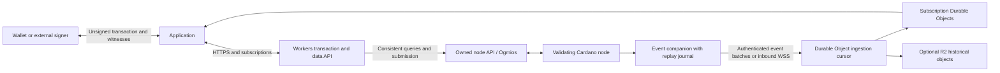
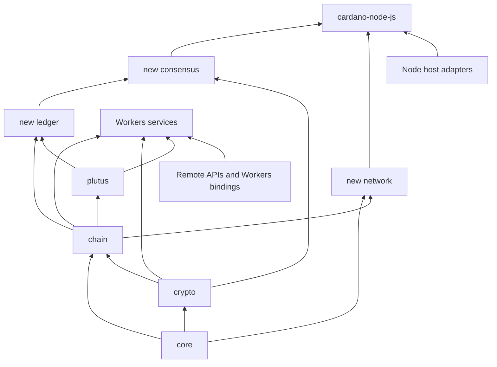

# Cardano node and Workers services: architecture, evidence, and delivery plan

Assessment date: 2026-09-24. Status: revised architectural proposal.

**Build two products from one portable protocol library:** a Workers service for Cardano data
and transactions, and an independently validating `cardano-node-js` for persistent servers.
The Workers service can deliver useful functionality much earlier. Its dependency on a remote
validating node must be explicit; the independent node can eventually replace that backend.

A pure TypeScript implementation of a Cardano node is technically possible. XRAY Cardano Lib
already supplies substantial primitives, but does not yet supply a complete ledger engine,
consensus engine, P2P stack, or durable node. Mainnet correctness, throughput, memory requirements,
and production suitability remain unproven.

“Pure TypeScript” here means protocol and cryptographic code compiled to JavaScript, without
a native cryptographic addon, WASM implementation, or Haskell subprocess implementing those rules.
Runtime sockets, storage, clocks, and secure randomness are still necessary. A Workers service
using a remote Haskell node has a pure TypeScript application layer, but the whole deployment
is not an independent TypeScript node.

This document is based on source, tests, ADRs, existing provider metadata, and official upstream
documentation. A local Ed25519 microbenchmark is recorded in the performance comparison below.
No chain replay, Rust/full-node benchmark, live Workers deployment, full snapshot integrity audit,
or full test-suite execution was performed for this revision. Proposed APIs, milestone IDs,
and acceptance targets below are design decisions, not existing capabilities.

**Cardano's main components, at a glance.**

| Component | What it does | Place in this project |
| --- | --- | --- |
| Transactions and blocks | Record transfers and other actions in an ordered chain | Reuse codecs and transaction models; add complete block processing |
| Ledger state | Tracks unspent outputs (eUTXOs), assets, stake, rewards and governance state; applies transaction and epoch rules | Build the complete state-transition engine around existing models |
| Consensus — Ouroboros | Determines block-production eligibility and selects the chain a node follows | Implement consensus, header validation and chain selection |
| Cryptography | Supplies hashes, signatures, keys, leader-election proofs and block-signing security | Reuse current primitives; add Cardano VRF/KES and qualify any native acceleration |
| Smart contracts | Native scripts and Plutus programs enforce transaction conditions | Integrate existing script/evaluator support with complete ledger validation |
| Peer-to-peer networking | Exchanges chain information, blocks and transactions between nodes | Implement native mini-protocols, peer management and transaction propagation |
| Storage | Persists blocks and ledger state, supporting synchronization, recovery and rollback | Implement the database, block store and rollback/checkpoint strategy described below |
| Interfaces | Connects wallets, explorers and applications to node services | Provide query, submission and subscription adapters; the Workers service starts here |

A full validating node combines these components to independently validate and follow the chain.
A block producer additionally manages stake-pool credentials and creates blocks when eligible.
A Workers gateway can provide selected transaction, verification and data services while relying
on a remote node for consensus and authoritative ledger state.

The detailed native-crypto replacement boundaries, compatibility findings and measured performance
are recorded in [CRYPTO-ENHANCEMENT.md](CRYPTO-ENHANCEMENT.md).

**The first plan needed a more explicit trust model and smaller implementation stages.**

| Issue in the initial plan | Enhancement |
| --- | --- |
| A native network follower was the only first deliverable | Add an earlier Workers transaction/data service using an existing validating backend |
| “Verify a transaction” could mean several different checks | Report signature, witness, script, ledger, and inclusion checks separately |
| Ledger implementation was one large stage | Split state/storage, transaction rules, scripts, epoch/governance rules, historical transitions, and replay |
| Remote inputs and protocol parameters were underspecified | Bind query results to a network and chain point; handle stale or inconsistent context explicitly |
| Workers connectivity focused on outbound TCP | Add HTTP query/submission, server-pushed events, WebSocket gateways, and an optional native TCP bridge |
| Snapshots were mentioned without an acquisition strategy | Inventory existing coverage; identify authoritative repositories, bounded selections, dependencies, and capture order |
| Completion was described at a high level | Add dependency-based development tables and an end-to-end acceptance matrix |
| “Pure TypeScript” did not distinguish code from deployment | Keep portable rules local; classify remote node, signer, and proof-verifier dependencies explicitly |
| Version compatibility had no operational lifecycle | Add compiled rule profiles, release manifests, activation handling, migration/recovery procedures and upgrade acceptance gates |

**The current repository supports transaction services more directly than node operation.**

| Existing owner | Observed foundation | Missing for the proposed products |
| --- | --- | --- |
| `core` | Lossless CBOR, preserved/canonical encoding, byte utilities, integer bounds and network identifiers | Incremental network framing and host adapters |
| `crypto` | Hashing, Ed25519, extended keys, Cardano BIP32, secp256k1 and BLS primitives | Cardano VRF/KES algorithms, protocol-specific verification coverage and producer lifecycle |
| `chain` | Byron–Conway models, transaction building, fees, witnesses and era-aware decoding | Full ledger state transitions and active-protocol acceptance rules |
| `plutus` | UPLC, CEK evaluation, costs, contexts and phase-two APIs | Complete ledger integration, additional compatibility review and measured host performance |
| `cip` | Formats including CIP-8 message signing | A wallet connection adapter and explicit CIP-30 evidence/scope |
| `runtime` | Universal ESM facade and package boundary checks | Node/application orchestration, without making those dependencies mandatory for all consumers |

There are several concrete reuse and correctness boundaries:

- Ordinary transaction signing already has `hash_transaction`, `make_vkey_witness`,
  `PrivateKey.sign`, and `PublicKey.verify`. New VRF/KES functionality is not a prerequisite
  for a payment transaction service.
  [Ledger helpers](../../packages/chain/src/ledger/operations.ts),
  [key implementation](../../packages/crypto/src/keys/ed25519.ts).
- `discover_required_witnesses` and `TransactionWitnessSetBuilder` provide useful assembly
  foundations. Witness discovery over supplied inputs is not a claim that those inputs are
  authentic, unspent, or sufficient for complete ledger validation.
  [Transaction and witness implementation](../../packages/chain/src/builder/transaction.ts).
- `VRFVkey` and `KESVkey` are fixed-size byte wrappers. They do not verify VRF proofs or KES
  signatures. [Key wrappers](../../packages/crypto/src/hashes/types.ts).
- Era validators check wire structure and bounds. Some unknown future fields are deliberately
  preserved. A node needs a separate strict acceptance boundary for the selected era/protocol,
  while keeping lossless inspection APIs useful.
  [Conway validation](../../packages/chain/src/era/conway/validation.ts).
- `evaluateRaw(..., runPhaseOne)` uses that flag for missing/extra redeemer-pointer checks,
  not complete phase-one validation. The generic evaluator must not become a broad
  `isValidTransaction` API.
  [Raw evaluator](../../packages/plutus/src/ledger/evaluate.ts).
- The current conformance test selects the older 1,003-case corpus. A newer captured UPLC
  corpus exists, with adoption questions recorded separately. Captured evidence is not proof
  that the current runtime passes it.
  [Conformance test](../../packages/plutus/test/conformance.test.mjs),
  [UPLC capture findings](../../../../.agents/spectre/providers/uplc/0002/CAPTURE.md).

The library's no-native/no-WASM policy fits this direction. Producer key handling remains a
separate concern: JavaScript cannot guarantee constant-time execution or secret erasure.
[Crypto ADR](../../../../docs/src/adr/typescript/0004-cryptography-primitives.md).

**Verification results should state exactly what has been checked.**

| Check | Can a Worker perform it? | What success establishes |
| --- | --- | --- |
| Decode and structural checks | Yes, using existing codecs | Bytes match supported structures and bounds |
| Transaction ID and Ed25519 witness verification | Yes, locally; no chain connection required | The supplied public key signed the exact transaction-body hash |
| Required signer/witness analysis | Partly available; needs resolved context | The specified witness requirements are satisfied under that context |
| Plutus execution and budget calculation | Locally where supported and within resource limits; otherwise explicitly delegated | Scripts execute under the supplied inputs, costs, era and protocol semantics |
| Full ledger validation | Requires the missing ledger engine plus sufficient authentic state, or a remote node | The transaction is valid against a particular ledger state and ruleset |
| Submission acceptance | Through a node/submission service | That backend accepted the submission; not that the chain included it |
| Chain inclusion and confirmation tracking | Via a follower; optionally strengthened by a supported proof scheme | Inclusion at an observed point, subject to the stated rollback/trust policy |

Do not expose only a single `verified: true`. A proposed result should include the transaction
ID, checks performed, missing checks, source identity, network identity, chain point,
ruleset/parameter identity, and whether verification was local or delegated.

A valid signature does not prove that the signer controls a consumed output, that every required
witness exists, that inputs remain unspent, or that the transaction is balanced. Remote state
can be authenticated as a statement from a server without becoming independently proven Cardano
state. Two agreeing providers can detect some mistakes; agreement alone is not a consensus proof.

**Workers can relay Cardano information through several practical architectures.**

| Option | Data path | Worker responsibilities | Trust and operating limits | Priority |
| --- | --- | --- | --- | --- |
| HTTP query and submission gateway | Application → Worker → owned node API/Ogmios; optional Kupo | Decode, build, verify witnesses, apply application policy, submit, expose status | Backend supplies ledger truth; short requests simplify recovery | First product |
| Server-pushed event relay | Node companion → authenticated HTTPS or inbound WebSocket → Durable Object → subscribers | Ordered ingestion, durable cursor, bounded projections, fan-out and rollback events | Companion supplies chain selection; requires replay and acknowledgments | Preferred continuous feed |
| Worker-initiated WebSocket follower | Durable Object → Ogmios → node | Chain intersection, roll-forward/backward handling and application indexing | Outgoing connections need lifecycle handling and cannot use WebSocket hibernation | Useful alternate adapter |
| Native outbound TCP follower | Durable Object → Ouroboros peer | Mux, handshake, ChainSync, BlockFetch and optionally duplex roles | No public inbound native listener; full validation remains separate work | Node networking experiment |
| Native TCP ingress bridge | Ordinary peer → external TCP gateway → WebSocket tunnel → Worker | Implement or forward native protocol sessions | Gateway is mandatory; extra latency and backpressure complexity | Optional interoperability experiment |
| Proof-verifying data service | Worker → Mithril aggregator/data source | Verify a supported certificate/proof scheme and bind returned content | Depends on scheme, trust anchor, certification coverage and freshness | Later research track |

Ogmios exposes ledger queries, transaction evaluation/submission, and chain synchronization.
Kupo adds indexed lookups for outputs, values, datums, and scripts. Prefer an owned node plus
Ogmios first; add Kupo when query patterns justify it. A commercial HTTP provider can be another
adapter, with its own completeness, consistency and availability contract.
[Ogmios query protocol](https://ogmios.dev/mini-protocols/local-state-query/),
[submission protocol](https://ogmios.dev/mini-protocols/local-tx-submission/),
[chain synchronization](https://ogmios.dev/mini-protocols/local-chain-sync/),
[Kupo repository](https://github.com/CardanoSolutions/kupo).

Ogmios' published documentation currently exposes versioned HTTP and WebSocket APIs. Pin the
actual deployed schema and supported methods; do not assume every WebSocket operation has
equivalent stateful behavior over HTTP.
[HTTP API reference](https://ogmios.dev/http-api/).

A native public relay and an application event relay are different products. Ordinary
`cardano-node` peers do not understand a custom HTTP/WebSocket event service. A conventional
relay maintains chain selection and ledger state; adding a TCP tunnel does not implement those
functions. [Reference node responsibilities](https://ouroboros-consensus.cardano.intersectmbo.org/docs/explanations/node_tasks/).

**Use the following topology for the first Workers product.**



The remote node is initially the reference Haskell node. Later it can be `cardano-node-js`
without changing the application's transaction or subscription contracts.

A server-pushed feed uses the Worker as the receiver, which fits request/event processing better
than depending on a perpetual outbound socket. An accepted inbound WebSocket can use Durable
Object hibernation; outgoing WebSockets cannot. Frequent chain traffic may still keep objects
active, so hibernation is not a promise of negligible cost.
[Durable Object WebSockets](https://developers.cloudflare.com/durable-objects/best-practices/websockets/).

Define an owned event envelope with `networkIdentity`, `streamId`, `generation`,
`sequence`, `kind`, `point`, `previousPoint`, and payload digest. Rollback events name the
target point. A server signature or authenticated transport identifies the publisher; neither
substitutes for chain validation.

Persist cursor and projection changes atomically before acknowledging an event. A publisher
keeps a replay journal and resumes after the last durable acknowledgment. Reject gaps, buffer
only within explicit bounds, and resynchronize at a common chain point after publisher failover.
An event ID must include stream/generation/sequence: a block can legitimately reappear after
rollback, so block hash alone is not an event-processing deduplication key.

Identify a chain point by slot and block hash, with an explicit origin value; slot alone does
not distinguish competing blocks. Store immutable block content by network and hash, and keep
canonical-chain membership separate. Bind mutable query caches to the full chain point and
ruleset rather than treating an address-keyed response as indefinitely current.

Start with one ordered ingestion coordinator per network/feed and separate subscriber groups.
Scale fan-out independently from chain ordering. Do not create an independent upstream
connection for every wallet. Disconnect slow consumers with a resumable cursor instead of
accumulating unbounded buffers.

Preserve original CBOR whenever hashing, signing, or byte-level validation depends on it.
A JSON block representation is useful for applications, but re-encoding it is not guaranteed
to recover original bytes. Require raw-CBOR capability from the selected source/companion
where needed; do not invent an Ogmios method that provides it.

**The transaction workflow can be implemented before native consensus.**

1. Authenticate the application request and bind it to a configured network, account and
   business operation. Check outputs, assets, change policy, fees and validity bounds.
   Testnet address network IDs alone do not distinguish preview from preprod; include the
   expected network magic/genesis identity in backend configuration.
2. Acquire a coherent ledger point. Obtain required UTxOs, protocol parameters, active cost
   models and era/slot information. Fetch datums/scripts and verify their hashes where
   applicable. Kupo/indexer observations need their own checkpoint and lag checks.
3. Build and, for scripts, evaluate a draft. Resolve fee, execution-unit, script-data-hash
   and change dependencies with a bounded rebuild/evaluation loop. Reject unsupported
   protocol versions instead of silently applying defaults from another version.
4. Freeze the final transaction body and expose a human-readable intent for authorization.
   Hash its exact bytes. Any later body change invalidates the signing request.
5. Request witnesses from a wallet or signer. Verify each returned witness against that body,
   then merge witnesses without rewriting the signed body. Recheck final serialized size,
   fees and completeness; extra witnesses can affect transaction size.
6. Submit the complete transaction. Persist both transaction ID and an exact submitted-payload
   digest, because distinct witness sets can share the same body/transaction ID.
7. Track `submitted`, `accepted-by-backend`, `included`, `rolled-back`, `expired`,
   `rejected`, and `unknown` separately. A timeout is an unknown outcome, not proof of
   rejection. Reconcile before rebuilding or authorizing another payment.
8. On rollback, retract the inclusion event and reassess inputs and validity. Resubmission of
   identical signed bytes may be appropriate; a changed transaction requires fresh authorization.

Ogmios can hold a ledger state at an acquired point, avoiding queries that accidentally straddle
different tips. Acquisition can expire or fail for old points. Do not silently replace a
requested point with the latest one.
[State acquisition semantics](https://ogmios.dev/mini-protocols/local-state-query/).

Use lossless parsing for JSON integer tokens beyond JavaScript's safe-integer range. Converting
an already rounded `number` to `bigint` cannot recover its original value. Apply explicit bounds
at the typed adapter boundary, including quantities, slot numbers and protocol parameters.

Do not assume a separate evaluation call uses the same acquired state as earlier queries.
Require an adapter capability/contract for that guarantee; otherwise report the limitation,
refresh context, and repeat evaluation when necessary. Ogmios explicitly distinguishes
script-budget evaluation from full ledger validation.
[Evaluation semantics](https://ogmios.dev/mini-protocols/local-tx-submission/).

CIP-30 `signTx` returns a witness set; partial signing can intentionally leave requirements
unsatisfied. CIP-8/`signData` is message signing and must not be treated as transaction
authorization. Pin the exact supported wallet interface and merge behavior.
[CIP-30](https://cips.cardano.org/cip/CIP-30),
[existing CIP-8 owner](../../packages/cip/src/cip8).

**Choose transaction-signing custody explicitly.**

| Mode | Key location | Worker role | Recommendation |
| --- | --- | --- | --- |
| User wallet | Browser wallet/hardware-backed wallet | Build, inspect, verify returned witnesses, submit | Default application flow |
| External service signer | Dedicated signer outside Workers | Send an authorized immutable request, verify response | Suitable for controlled service accounts |
| Worker-held key | Worker secret available to application code | Locally sign using existing library primitives | Technically feasible; a separate custodial deployment decision |
| Stake-pool producer | Dedicated producer key environment | Eventually VRF/KES and block-forging orchestration | Separate from ordinary transaction signing |

For a service signer, bind authorization to network, exact body hash, allowed key role, intent,
limits and expiry. A signer should validate authorized intent against the actual body, not
blindly sign arbitrary hashes from a public endpoint. A durable application operation ID can
prevent repeated spending after retries, but does not reserve UTxOs on the Cardano network.

Workers secrets supply encrypted configuration values that Worker code can read; they do not
make a loaded signing key non-exportable. An external signer changes the trust boundary and
must support the required Cardano key/signature format; generic KMS support must be verified.
Keep remote signing in application adapters rather than replacing local library cryptography.
[Workers secrets](https://developers.cloudflare.com/workers/configuration/secrets/),
[repository crypto policy](../../../../docs/src/adr/typescript/0002-cryptography-dependency-policy.md).

**Workers deployment constraints should shape the implementation, not settle feasibility by themselves.**

| Documented constraint | Design consequence |
| --- | --- |
| Outbound TCP is available; inbound raw TCP is not | Use HTTP/WSS application endpoints, outbound peers, or an external native gateway |
| 128 MB per isolate | Bound decoded objects, buffers and concurrency; stream historical data |
| Paid HTTP invocations default to 30 seconds CPU and allow up to five minutes | Bound jobs and measure CPU; network waiting and CPU time are different |
| HTTP wall time can continue while the caller stays connected | Long streams are possible, but cancellation and restart remain normal |
| SQLite-backed Durable Objects have a 10 GB paid-plan limit per object | Store bounded projections and cursors; design archive/state partitioning explicitly |
| Outbound sockets defer DO eviction only for a bounded period | Persist intersection points and reconnect; do not rely on process memory |

These limits come from [Workers TCP documentation](https://developers.cloudflare.com/workers/runtime-apis/tcp-sockets/),
[Workers limits](https://developers.cloudflare.com/workers/platform/limits/),
[DO limits](https://developers.cloudflare.com/durable-objects/platform/limits/), and
[DO lifecycle](https://developers.cloudflare.com/durable-objects/concepts/durable-object-lifecycle/).

An outbound-established Ouroboros connection can negotiate duplex roles; lack of inbound TCP
does not prohibit every relay interaction or outbound-connected producer. It does prevent
a generally reachable native listener on Workers alone.
[Network specification](https://ouroboros-network.cardano.intersectmbo.org/pdfs/network-spec/network-spec.pdf).

Use KV for tolerantly stale caches, not the authoritative selected tip, signer deduplication,
or atomic ledger updates. Its consistency model does not provide those guarantees.
[KV consistency](https://developers.cloudflare.com/kv/concepts/how-kv-works/).
Queues are useful for deferred delivery and notifications, but consumers must deduplicate
at-least-once delivery and enforce application sequence independently.
[Queue delivery](https://developers.cloudflare.com/queues/reference/delivery-guarantees/).

A distributed full validator built across Workers/storage is a research possibility, not
excluded merely by 128 MB memory. It would need coherent state views, atomic commit visibility,
rollback, crash recovery and efficient cross-partition access. Scaling request handlers does
not remove the ordered dependency of each ledger transition on its predecessor.

For block production, alarms are not an exactly-once or precise slot scheduler. They may retry
and can be delayed during failures. KES evolution, fencing, durable signing history and restoration
from backup need dedicated design; a lease alone cannot revoke a signing secret copied elsewhere.
[Alarm guarantees](https://developers.cloudflare.com/durable-objects/api/alarms/),
[alarm timing](https://developers.cloudflare.com/durable-objects/api/sqlite-storage-api/).
Start production on persistent servers. Cloudflare Containers are a separate deployment option
and do not automatically provide arbitrary public TCP ingress.
[Container architecture](https://developers.cloudflare.com/containers/concepts/architecture/).

**Mithril can strengthen selected data claims, but requires its own implementation scope.**

A proof-verifying service should validate the certificate chain from an explicitly configured
trust anchor, the certified message and inclusion proof, the supported entity type, and the
returned data's binding to the certified identifiers. Record the certified range and freshness.
Do not turn “transaction included in certified history” into “its outputs are currently unspent”
or “this proposed spending transaction is valid.”

The official JavaScript-facing Mithril client uses WASM, which conflicts with the current
library policy. An independent pure TypeScript verifier needs more than the existing BLS
operations: the exact certificate, STM, serialization and membership-proof rules must be
implemented and tested. A remote verifier is another service trust assumption.
[Official Mithril client](https://mithril.network/doc/manual/develop/nodes/mithril-client-library-wasm/),
[Mithril implementation](https://github.com/IntersectMBO/mithril).

Do not infer a generic authenticated UTxO-query API from normal block headers or from
transaction inclusion proofs. Each stronger claim needs a specified proof and trust model.
Keep the basic Workers service useful without depending on this research track.

**Keep reusable protocol rules separate from hosts and remote services.**

| Proposed owner | Responsibility |
| --- | --- |
| Existing `core/crypto/chain/plutus/cip` | Reuse current nominal types, codecs, local signing and script functionality |
| New `network` library package | Byte framing, mux, message codecs and protocol state machines over an abstract transport |
| New `ledger` library package | Deterministic transaction/block/epoch/era rules and explicit state changes |
| New `consensus` library package | Header/protocol validation, selection, leadership and forging rules |
| Separate `cardano-node-js` application | Peers, storage, mempool, synchronization, scheduling, process lifecycle and operations |
| Separate Workers service application | Query/submission adapters, event contracts, signing policy, subscriptions and host bindings |
| Optional future proof package | Locally implemented, explicitly scoped proof verification |



Arrows mean “used by”; this is an ownership outline. `chain` must not import the new ledger
engine, since `plutus` already imports `chain`. Keep network-specific and `node:*` imports
outside the universal protocol packages. New packages require explicit exports, dependency
rules and focused entry points so wallets do not import an entire node.

Specify host contracts for byte transport, cancellation, clocks, durable state views and atomic
batches. Ledger computation should receive the state entries it needs and emit changes;
storage should preserve snapshot identity and commit visibility. Reuse existing nominal types
instead of creating an alternative transaction hierarchy.

For the first full node, use a versioned append-only block store plus a transactional ledger
store, selected-tip pointer and rollback journal. Define a crash-consistent commit order and
test every interruption point. Database format compatibility with the Haskell node is not
required for network compatibility; import/export formats should be explicit.

Treat streaming CBOR and cancellation as design requirements: network reads can split any
message or contain several messages, and CPU-heavy script work must not starve peer handling.
On Node.js, isolate expensive work when useful while committing ledger transitions in order.
On Workers, reject or delegate jobs that exceed advertised local capabilities; report delegation.

**The Node.js application should use worker threads for CPU parallelism.**

Node's `worker_threads` executes JavaScript in parallel. A reusable pool fits CPU-heavy work;
ordinary asynchronous socket I/O can remain on the networking event loop. `Promise.all` alone
does not distribute synchronous TypeScript computation across CPU cores.
[Node worker threads](https://nodejs.org/api/worker_threads.html).

| Execution role | Proposed responsibilities | Ownership constraint |
| --- | --- | --- |
| Networking/main thread | Peer sockets, framing, bounded ingress/egress, timers, API and process supervision | Performs bounded work and sends validation/state requests to the coordinator |
| Ledger/storage coordinator thread | Resolve ordered ledger context, coordinate validation, select/restore state and commit ledger changes | Owns authoritative mutable state and the database write connection |
| Reusable validation worker pool | Batched hashing and witness checks; cryptographic VRF/KES verification; prepared Plutus evaluations; selected decoding work where benchmarks justify it | Receives immutable inputs and returns results; cannot mutate the ledger or select the canonical chain |
| Optional producer signing owner | Authorized leadership/forging work and durable key lifecycle | Holds exclusive signing authority; private keys are not copied into the general validation pool |

Keep `node:worker_threads`, worker startup and database imports in application host adapters.
XRAY exports deterministic protocol functions that run within each worker. The same library
can still run sequentially on another host; adopting Node threads adds no native cryptography
or WASM dependency to the portable packages. This is the server execution model, independent
of the Workers service's distributed request/event model.

The first implementation should parallelize expensive checks while retaining one ordered
ledger transition/commit path. A later transaction can consume an earlier transaction's output,
so arbitrary transactions or blocks cannot independently update one shared UTxO map. Prepare
each script job only after resolving its exact inputs, script context, rules and costs against
the correct tentative ledger view. Stateless prechecks for later blocks may run ahead within
bounds, but accepting/committing those blocks still depends on their predecessors.

The coordinator accepts a block only after all required checks pass under its applicable
rules, aggregates execution budgets and commits state, undo information and selected tip
consistently. Worker completion order must not affect acceptance, canonical chain choice or
the reproducible ordering of reported failures. Parallel results are evidence for that decision,
not permission for individual workers to commit transactions.

Give each job a task ID, input digest, chain/ledger-view identity, rule revision, parameter
identity and coordinator generation. Results must match the outstanding request. After a fork
switch, migration or software/rules-context change, cancel or discard affected stale jobs.
Workers must run the expected application/library build and job-schema version before accepting
tasks; do not hot-swap evaluator code underneath outstanding work.

Use raw preserved CBOR/byte arrays and explicit message records at thread boundaries. Structured
cloning does not preserve class prototypes or non-enumerable metadata, so sending XRAY class
instances directly can lose methods and encoding information. Transfer owned `ArrayBuffer`s
only when the sender relinquishes them; retain required block bytes separately. Start with
message passing rather than a shared mutable ledger. Shared buffers need a separate ownership
and synchronization design if profiling later justifies them.
[Thread message semantics](https://nodejs.org/api/worker_threads.html#considerations-when-cloning-objects-with-prototypes-classes-and-accessors).

For the proposed SQLite adapter, keep its write connection in the ledger/storage thread.
`DatabaseSync` calls are synchronous; moving their owner off the networking thread keeps those
calls from blocking peer I/O. WAL allows readers alongside a writer but still permits only one
writer at a time. Any separate read connections must return an explicit snapshot/chain point;
they cannot provide arbitrary latest-state reads to an older validation job.
[Node SQLite](https://nodejs.org/api/sqlite.html), [SQLite WAL](https://sqlite.org/wal.html).

Bound queued task count, queued bytes and per-worker memory. Batch small crypto checks so
message overhead does not dominate. Prioritize live-chain and time-sensitive production work
over historical catch-up or mempool load. A worker crash, cancellation or host timeout is an
operational failure requiring retry/degradation, not proof of an invalid transaction; preserve
the distinction from deterministic script failure or protocol-budget exhaustion. General
validation jobs can be retried because they have no external side effects.

Start with a configurable small pool and benchmark 1, 2 and 4 validation workers where hardware
permits. Budget for the coordinator, networking, database I/O and the memory consumed by each
worker. Measure validation throughput, propagation latency, event-loop delay, job transfer cost,
queue depth and total process memory; additional threads do not guarantee linear speedup.

G2 should establish the sequential baseline and parallel-job contract. N3/N6 introduce pooled
crypto/script work as those rules become available; N4 owns the exclusive storage writer; N10/N11
add load and production-priority qualification. Require identical sequential/parallel ledger
outcomes and budgets under reordered completions, worker crashes, rollback during evaluation,
queue saturation and protocol transitions. Pin the selected Node release's worker/message and
SQLite APIs as host evidence, with relevant tests from the
[Node repository](https://github.com/nodejs/node); retain SQLite WAL documentation for the
storage concurrency contract. No thread pool has been implemented or benchmarked by this plan.

**SPECTRE evidence acquisition should start from the coverage that already exists.**

This revision recommends captures; it does not create provider guides, snapshots, implementation
records or ledger rows. The installed router distinguishes discussing evidence from authorizing
a lifecycle operation. Future provider preparation/capture and implementation planning must
select explicit scopes. See the [SPECTRE skill](../../../../.agents/skills/spectre/SKILL.md) and
[provider format](../../../../.agents/spectre/templates/TEMPLATE_PROVIDER.md).

| Existing provider | Available captures inspected at metadata level | Useful coverage | Additional work needed |
| --- | --- | --- | --- |
| `cardano-ledger` | [0001](../../../../.agents/spectre/providers/cardano-ledger/0001/SNAPSHOT.md) | Seven Byron–Conway CDDL files plus legal material | Explicitly expand future selection to transition rules, state, epoch/era logic and tests; the present capture is not a ledger-engine specification |
| `uplc` | [0001](../../../../.agents/spectre/providers/uplc/0001/SNAPSHOT.md), [0002](../../../../.agents/spectre/providers/uplc/0002/SNAPSHOT.md) | UPLC implementation/costs/corpus and selected ledger integration | Resolve corpus adoption and protocol availability; expand source closure for any newly selected behavior |
| `cardano-multiplatform-lib` | [0001](../../../../.agents/spectre/providers/cardano-multiplatform-lib/0001/SNAPSHOT.md), [0002](../../../../.agents/spectre/providers/cardano-multiplatform-lib/0002/SNAPSHOT.md) | Historical vectors, serialization, selected builder/collection behavior | Reuse as comparison; official ledger remains semantic authority |
| `cardano-cips` | [0001](../../../../.agents/spectre/providers/cardano-cips/0001/SNAPSHOT.md) | Selected encodings, addresses, keys, assets and governance formats | CIP-30 is explicitly excluded from that capture; add a separately authorized selection for wallet signing and relevant CIP-8 material |
| `message-signing` | [0001](../../../../.agents/spectre/providers/message-signing/0001/SNAPSHOT.md) | CIP-8/COSE implementation evidence | Reuse for message signing only; not a substitute for transaction-signing rules |

The UPLC provider currently declares maintained protocols 5–11; its newer captured upstream
contains future functionality outside that scope. Define support from the selected network and
release before claiming current-mainnet coverage. Era names, ledger protocol versions, Plutus
language/semantics versions and node-to-node versions are separate compatibility dimensions.
[UPLC provider guidance](../../../../.agents/spectre/providers/uplc/PROVIDER.md).

**Use this source catalogue for future captures.** `E01`–`E13` are planning labels only, not
SPECTRE pin IDs or reserved capture numbers. Repositories and documentation below were checked
as discovery sources. The proposed path families must be resolved into exact regular-file
allowlists, dependency closures and immutable identities when a capture is prepared.

| Label / priority | Authoritative repository or URL | Proposed bounded selection | Intended consumer |
| --- | --- | --- | --- |
| E01 / first | [cardano-node](https://github.com/IntersectMBO/cardano-node), [CHaP](https://github.com/IntersectMBO/cardano-haskell-packages), [official environments](https://book.world.dev.cardano.org/environments.html) | Selected release metadata; `cabal.project`, relevant package/build resolution and lock metadata; node configuration and genesis identities for the chosen network; matching release notes, compatibility and migration guidance | Compatibility baseline, reference deployment, upgrades and network identity |
| E02 / first | [Ogmios](https://github.com/CardanoSolutions/ogmios), [query docs](https://ogmios.dev/mini-protocols/local-state-query/), [submission docs](https://ogmios.dev/mini-protocols/local-tx-submission/) | Versioned API schemas, matching `clients/TypeScript` contracts, relevant `server` codecs/handlers and vectors for queries, evaluation, submission and chain sync; their error cases | Workers backend adapter and reference responses |
| E03 / first | [Cardano CIPs](https://github.com/cardano-foundation/CIPs), [CIP-30](https://cips.cardano.org/cip/CIP-30) | `CIP-0030`, relevant `CIP-0008`, and existing address/key specifications such as `CIP-0019`/`CIP-1852`; statuses, schemas, vectors and licenses | Wallet signing, witness exchange, address/network handling |
| E04 / first | [Cloudflare docs source](https://github.com/cloudflare/cloudflare-docs), [workerd](https://github.com/cloudflare/workerd), [Workers SDK](https://github.com/cloudflare/workers-sdk) | Docs for sockets, limits, DO lifecycle/storage/WebSockets/alarms, secrets, queues, deployments and rollback; exact SDK/runtime versions and narrowly relevant compatibility/migration tests | Workers host adapter, upgrade behavior and operational constraints; not Cardano semantics |
| E05 / as needed | [Kupo](https://github.com/CardanoSolutions/kupo), [API documentation](https://cardanosolutions.github.io/kupo/) | API schema/docs, selected HTTP query and checkpoint/rollback code and tests from `src`, `test`, `test-accept`; datum/script retrieval and index coverage behavior | Optional indexed-data adapter |
| E06 / native node | [Ouroboros Network](https://github.com/IntersectMBO/ouroboros-network), [network specification](https://ouroboros-network.cardano.intersectmbo.org/pdfs/network-spec/network-spec.pdf), [typed-protocols](https://github.com/IntersectMBO/typed-protocols) | `network-mux`, selected protocol/version modules under `ouroboros-network`, relevant `cardano-diffusion` configuration and tests; state/agency, limits, timeouts, pipelining and duplex rules | New `network` package and peer interoperability |
| E07 / native node | [cardano-base](https://github.com/IntersectMBO/cardano-base) | Required KES/DSIGN/hash code and tests in `cardano-crypto-class`; `cardano-crypto-praos` VRF sources, C reference routines, vectors and rejection behavior; selected `cardano-slotting` definitions | VRF/KES, exact signature behavior, slot/epoch foundations |
| E08 / native node | [cardano-ledger](https://github.com/IntersectMBO/cardano-ledger), [ledger interaction](https://ouroboros-consensus.cardano.intersectmbo.org/docs/explanations/ledger_interaction/) | Explicit era-specific rules/state/serialization/tests under `eras`; required shared `libs`; formal rules, enactment, protocol-version gates and transitions; TPraos and numerical helper dependencies where required | New ledger engine, upgrade activation, historical compatibility and ledger view |
| E09 / native node | [Ouroboros Consensus](https://github.com/IntersectMBO/ouroboros-consensus), [consensus documentation](https://ouroboros-consensus.cardano.intersectmbo.org/) | Selected `ouroboros-consensus-protocol`, `ouroboros-consensus-cardano`, consensus/storage/mempool and diffusion interfaces; hard-fork, selection, bootstrap, forging and simulation tests | Consensus and node runtime |
| E10 / scripts | [Plutus](https://github.com/IntersectMBO/plutus), existing `uplc` provider | Version/semantics availability, CEK/Flat/builtins/costs, complete selected conformance corpus, ledger-api and matching ledger context integration | Local evaluation and consensus-visible script behavior |
| E11 / validation | [cardano-api](https://github.com/IntersectMBO/cardano-api), [cardano-node-tests](https://github.com/IntersectMBO/cardano-node-tests) | Serialization, witness and query golden tests; selected transaction, script, governance and network scenarios with deterministic expected outcomes and supporting fixtures | Differential oracle and end-to-end scenario design |
| E12 / optional proofs | [Mithril](https://github.com/IntersectMBO/mithril), [client specification/docs](https://mithril.network/doc/manual/develop/nodes/mithril-client-library-wasm/) | Supported certificate/entity schemas, `mithril-stm`, relevant `mithril-common`/`mithril-client` verification paths, trust-anchor handling, vectors and API examples | A separately scoped pure-TypeScript proof verifier |
| E13 / comparison | Existing CML captures; [Pallas](https://github.com/txpipe/pallas), [Amaru](https://github.com/pragma-org/amaru), [HarmonicLabs protocols](https://github.com/HarmonicLabs/ouroboros-miniprotocols-ts) | Only selected alternative codecs, protocol transitions, tests or implementation strategies relevant to a named gap | Cross-checks and implementation design; not overriding official protocol authority |

For E07, identify the exact VRF algorithm used by each selected protocol rather than assuming
an arbitrary ECVRF package is compatible. `cardano-crypto-praos` exposes distinct Praos and
batch-compatible variants and separate vector sets. Pin the selected implementation and its
dependent routines. Similarly pin KES composition, serialization and period-boundary behavior.
[Crypto package definition](https://github.com/IntersectMBO/cardano-base/blob/master/cardano-crypto-praos/cardano-crypto-praos.cabal).

Existing Noble dependencies can support implementations, but their APIs do not establish Cardano
acceptance rules. Supplement the current dependency decision with exact-version relevant vectors
and security material from [noble-curves](https://github.com/paulmillr/noble-curves) and
[noble-hashes](https://github.com/paulmillr/noble-hashes) when required. Do not automatically upgrade
the runtime dependencies while acquiring evidence.

The [formal ledger specifications](https://github.com/IntersectMBO/formal-ledger-specifications)
are an additional source for the selected rules, especially governance/conformance work. Record
which era/version they describe and how they correspond to the reference implementation.
Do not assume one formal specification covers every historical era or resolves a mismatch
without investigation.

**Capture a compatible release set, not unrelated repository tips.**

First select a reference node release appropriate to the intended network, and record its
full commit, binary/container digest, genesis/configuration hashes and actual dependency
resolution. Trace Ledger, Plutus, Consensus, Network and crypto dependencies through the node
build metadata and CHaP where necessary. A node release tag by itself does not pin all transitive
semantics. [Node dependency manifest](https://github.com/IntersectMBO/cardano-node/blob/master/cabal.project).

Existing provider tracking policies remain authoritative for capture discovery. Where a provider
tracks live upstream, capture that declared source and explicitly identify a release-matched
comparison source if needed. Do not silently freeze its branch or mix comparison files into
the primary identity. A future implementation must select one coherent behavior baseline and
explain newer captured material that is intentionally not active.

Each compatibility record should distinguish:

- network magic, genesis identities and era history;
- reference node build and resolved package identities;
- accepted node-to-node and node-to-client versions;
- ledger era and protocol major/minor versions;
- Plutus language, semantics variant and active cost-model identity;
- bootstrap mode and checkpoint/proof trust assumptions;
- Workers compatibility date, SDK/runtime versions, enabled flags and deployment plan limits.

Do not copy moving protocol parameters from a README into node constants. Use genesis/configuration
where the protocol requires it, and evolve on-chain parameters through ledger rules. For a
remote-backed service, retain the parameter source and chain point with each operation.

**Node releases and protocol upgrades need separate lifecycles.**

The previous plan named compatibility dimensions but left the operational upgrade mechanism
implicit. The proposed policy is: **deploy software containing the required rules before their
activation; select active rules from the chain's validated state.** Installing a package does
not enact a Cardano upgrade, and observing a new protocol number does not implement its rules.

| Version / identity | Who changes it? | What our implementation does |
| --- | --- | --- |
| `cardano-node-js` application release | Project maintainers and operators | Deploy an immutable build with an independent application version and exact library dependencies |
| XRAY library package versions | Library maintainers | Publish reviewed API/behavior changes; record a tested package set rather than infer compatibility from similar version numbers |
| Reference Haskell node release | Upstream maintainers | Review its changes and resolved dependencies; update our reference baseline when justified, without copying its software version into our protocol selector |
| Ledger era and protocol major/minor | The selected chain's era-specific governance and transition rules | Derive the active rules from ledger state and ticking; support explicit combinations, including multiple protocol versions inside one era |
| Protocol parameters and cost models | Valid ledger updates on that chain | Apply supported parameter changes as state transitions; bind application queries and evaluation to their point and parameter identity |
| Node-to-node / node-to-client wire versions | Each connection's handshake within supported capabilities | Negotiate an implemented version; this does not decide ledger or Plutus semantics |
| Plutus language, program version and semantics | Script bytes plus protocol-defined availability and evaluation rules | Select the permitted decoder, builtins, semantics and costs for that context; never use the newest evaluator indiscriminately |
| Storage schema, snapshot format, application API and event schema | Their owning application/library | Maintain explicit reader/writer and migration contracts independently of Cardano protocol versions |
| Workers deployment/runtime compatibility | Application deployment and platform configuration | Pin the compatibility date/flags and tested bindings; validate rollout and storage compatibility separately |

Cardano's governance design distinguishes hard-fork initiation from other parameter changes,
and software must support new behavior before activation. An era can contain several major
protocol versions; a version increase need not change its transaction-era tag. Historical
governance mechanisms also differ. Use the selected release's ledger/consensus implementation
for exact enactment and transition behavior, with CIPs as supporting evidence.
[CIP-1694](https://cips.cardano.org/cip/CIP-1694),
[era transition governance](https://ouroboros-consensus.cardano.intersectmbo.org/docs/references/miscellaneous/era_transition_governance/).

An upstream maintenance release may change only operations or packaging; that need not trigger
a protocol implementation change here. Conversely, a cryptography, serialization or evaluator
bug fix can affect accepted blocks despite an unchanged public API. Classify actual behavior
changes, not just the upstream SemVer label. Our own API version and security-fix status must
remain separate from the protocol combinations that a release implements.

Correcting our implementation of protocol `p` receives a new implementation revision rather
than inventing an on-chain protocol increment. Distinguish our errors from historical quirks
that are part of Cardano's consensus behavior: those remain required until the governing rules
change them. Investigate reference disagreements before treating a proposed fix as authoritative.
Determine whether previously derived state needs replay, then publish the corrected behavior
and affected-state boundary in the release report.

**Implement a compiled rules registry and explicit execution context.**

The existing raw phase-two API already takes `protocolMajorVersion` and cost models. Its
implementation accepts majors 5–11 and selects language/builtin/semantics behavior using that
argument. This is a reuse point, not a node-wide upgrade controller or a complete compatibility
claim. Raising `assertProtocol`'s upper bound alone would be incorrect.
[Phase-two API](../../packages/plutus/src/api.ts),
[protocol checks and semantics selection](../../packages/plutus/src/ledger/evaluate.ts).

Add an owned, immutable registry of supported rule profiles. Each profile identifies its exact
era/protocol applicability, ledger/header rules, supported Plutus combinations, parameter
decoding rules and any era-transition function. Keep implementations in their domain owners;
the application assembles a tested set. Profiles are compiled, reviewed TypeScript, not scripts
downloaded from a peer, governance URL, provider snapshot, or mutable remote configuration.
Do not infer support for every lower number from one `maximumProtocolVersion` constant, and do
not ignore the protocol minor version unless the selected evidence proves that is appropriate.

Pass an immutable context containing network/configuration identity, ledger-view identity,
chain point, target slot, active era/protocol, selected rule profile and parameter/cost-model
identity. Keep a rule revision separate from the parameter-set digest: changing a supported fee
parameter does not necessarily require deploying code. The context is per ledger view, not
one process-global `currentProtocolVersion`; historical replay and competing forks can require
different contexts at the same time.

For a full node, derive this context through locally validated ledger transitions, including
ticking to the candidate slot and era translation. A header's advertised version is an input
to validation, not permission to select arbitrary rules. For the Workers service, derive it
from the acquired remote state and retain the backend trust label. Governance observations and
announced dates support readiness alerts; they do not replace validated activation. Restrict
forced era/epoch overrides to explicitly isolated development networks.
[Header validity and ledger views](https://ouroboros-consensus.cardano.intersectmbo.org/docs/references/miscellaneous/hard_won_wisdom/),
[ticking across era boundaries](https://ouroboros-consensus.cardano.intersectmbo.org/docs/explanations/ticking/).

Keep past rules available for the advertised replay history. On an accepted chain rollback,
restore the corresponding ledger view, parameters and rules context; do not keep a permanently
increasing global version flag. Where a rollback crosses a transition within the protocol's
permitted rollback window, recovery may restore an earlier checkpoint and replay rather than
require an inverse of every era translation. Preserve existing historical byte interpretation
unless a reviewed correctness fix explicitly requires revalidation.

Invalidate or version derived caches, and revalidate the mempool at rule/parameter changes.
An evaluation cache needs the full relevant transaction/input context, rule revision and cost
model, not just a script hash. Retain the context used for each in-flight signing operation.
If it becomes stale, reassess the same signed bytes or request fresh authorization for a changed
body. For a known upcoming boundary, initially choose a transaction validity bound before it
unless the service has proven the transaction class works across that transition. This is an
application policy, not an additional Cardano consensus rule.

Ordinary updates to already supported parameters can apply without a software release. A new
parameter format, builtin, language, or semantic rule needs implementation and validation.
Updated resource limits may also require capacity work: local memory/CPU exhaustion must not
be misreported as proof that a protocol-valid block is invalid.

**Every release should carry a machine-readable compatibility manifest.**

Propose a release artifact named `RELEASE.json`; it does not exist yet. It should record:

- application version, source commit, artifact digest, exact package versions and lockfile digest;
- supported rule profiles and historical replay scope, with immutable evidence identifiers;
- reference-node build/dependency identities and hashes of required network/genesis configuration;
- accepted wire versions and supported backend, wallet, API and event-schema contracts;
- storage/snapshot read and write formats, migration paths and compatible downgrade targets;
- runtime requirements, Workers compatibility date/flags, validation report and security-fix floor.

Publish the manifest with authenticated release artifacts. Evidence is a build/review input;
published libraries still do not fetch or execute snapshot artifacts at runtime. A startup
preflight checks network identity, stored state/format, installed rules and runtime requirements
before enabling validation or production. A proposed capability endpoint exposes installed and
observed-active support separately, plus the last validated point and any upgrade requirement.
An unsupported future header from one peer alone must not globally disable the node.

If a legitimately required transition is unsupported, preserve the last supported validated
state, stop advancing the validated tip and stop production. Continue bounded diagnostics and
clearly labelled historical reads; do not pretend the stale node remains current. For Workers,
disable unsupported construction, evaluation and service signing independently of operations
that remain valid, such as checking an Ed25519 witness over supplied body bytes. A separately
advertised opaque submission/data gateway may continue through a supported remote backend,
but it must not label those transactions locally ledger-validated.

**Use this release procedure for each relevant upstream or network upgrade.**

| Step | Concrete work | Required outcome |
| --- | --- | --- |
| 1. Discover and classify | Monitor official releases, selected dependency changes, network governance state and platform notices; classify wire, ledger, crypto, script, parameter, API and storage effects | Impact report identifies affected owners, active networks, required deployment window and whether code changes are needed |
| 2. Freeze the baseline | Select a coherent target release set; prepare the bounded immutable evidence delta under existing provider policies | Full source identities and old/new rule differences; no mixing unrelated upstream tips |
| 3. Implement support | Add or revise owned rule profiles, transition logic, codecs, backend adapters and migrations as needed | Old supported history remains interpretable; new behavior stays inactive until the applicable context selects it |
| 4. Prove the boundary | Differential replay, negative vectors and a private-network upgrade rehearsal; test both software versions around activation | Exact activation, pre-activation rejection, post-activation behavior, rollback and crash recovery match the declared reference |
| 5. Package and rehearse deployment | Produce immutable artifacts/manifest; migrate a copy of state; run a shadow follower without signing authority | Reproducible installation, measured recovery and an explicit safe rollback target or forward-fix procedure |
| 6. Roll out before activation | Upgrade a canary, then relay/follower instances; promote a caught-up producer only after validation and signing-authority handoff | All required instances are ready before the network transition; old instances cannot accidentally produce after losing authority |
| 7. Observe activation and retain evidence | Select rules from the chain, refresh affected application context, compare state/results and watch resource use | No unexplained divergence; unsupported instances report upgrade-required; release evidence and operational observations are retained |

Source discovery should alert maintainers rather than auto-upgrade consensus code in production.
Capturing upstream changes does not implement or approve them. Where the existing repository
workflow applies, preparation, implementation, review and acceptance remain separate operations;
this document schedules none of them. Monitoring can be automated, but a network announcement
must never cause an unattended `npm update` or runtime code substitution.

**Software rollback, chain rollback and storage migration are different operations.**

| Situation | Allowed recovery |
| --- | --- |
| New build fails before activation | Redeploy a tested earlier build only if it supports the active rules, present storage format and required security fixes |
| Network has activated rules absent from the old build | Use a fixed/newer build or another already compatible build; restoring old software cannot downgrade the network |
| Node selects a different valid fork | Apply the consensus rollback procedure and restore/replay the corresponding state; this is not a software deployment rollback |
| On-disk representation changes | Use a checkpointed, restartable migration with an exclusive writer and tested recovery; retain a coherent backup or a separate database until cutover is proven |
| A bug produced incorrect derived ledger state | Identify the earliest affected point; discard/rebuild affected derived state from a trustworthy earlier point and retained blocks, even if schema numbers are unchanged |
| Producer or service signer is rolled back | Preserve the current signing-operation journal, fencing state and key/certificate lifecycle; restoring application data must not restore old signing authority or replay completed payments |

Separate format migration from consensus era translation: one converts our storage layout, the
other changes ledger semantics according to the chain. Record schema, network, checkpoint and
validating-build identities in state metadata. Refuse unsupported formats before opening a
write path. The first implementation should prefer a stopped-writer migration or separate
database rebuild over concurrent old/new node processes writing one database.

A release that fixes past validation cannot trust an old snapshot merely because it decodes.
Declare its minimum trustworthy replay/checkpoint boundary and invalidated cache/state versions.
For producer recovery, never rewind KES evolution or operational-certificate counters from a
general application backup. A shadow producer has no signing authority until an explicit,
tested handoff; a lease does not erase secrets from the previous process.

**Workers upgrades must tolerate mixed application versions without splitting ordered state.**

Deploy backend/node support, compatible API adapters and Workers capabilities before advertising
the new transaction scope. Keep old/new request, response and event envelopes interoperable for
the rollout window. Introduce storage fields in an additive phase, backfill idempotently, move
readers/writers, and remove obsolete fields only after the rollback window closes. Version saved
operations so an older handler cannot silently reinterpret a newly authorized signing request.

Cloudflare code versions do not version associated storage state, and rolling back Worker code
does not restore that state. Certain Durable Object lifecycle changes also prevent rollback to
earlier versions. Distinguish platform class/binding changes from application SQL/KV migrations
inside an existing object; both require their own tested recovery plan.
[Workers versions](https://developers.cloudflare.com/workers/versions-and-deployments/),
[rollback limits](https://developers.cloudflare.com/workers/versions-and-deployments/rollbacks/).

Gradual deployment assigns a version to each Durable Object, rather than splitting requests
to the same object between versions. A single network ingestion coordinator therefore needs
an explicit cutover and resumable cursor. Canary the new ingestion implementation against a
separate journal/projection in shadow mode; do not expect a percentage rollout to duplicate its
ordered work safely. Keep signer/payment deduplication state shared and authoritative across
versions instead of creating a second live signer to canary payments.
[Durable Object deployment behavior](https://developers.cloudflare.com/changelog/post/2026-08-20-durable-objects-deployments-tab/).

**Upgrade support is required delivery work, not a final operations note.**

The following milestones extend the development tables below. They are proposed work labels,
not implementation records; their partial dependencies avoid delaying the Workers product
until a native node exists.

| ID | Depends on | Deliverable and owner | End-to-end exit criterion | Evidence |
| --- | --- | --- | --- | --- |
| U1 | G0, G2 | Compatibility manifest, exact package set, capability model and owned rules-registry contract | Distinguish installed support from active state; reject unsupported combinations without breaking supported historical inspection | E01, E08–E10 for native rules; existing owners |
| U2 | U1, W1, W3, W5 | Workers/backend upgrade path, operation-context versioning and durable schema/cursor migration | Old/new deployments interoperate; parameter/era changes invalidate stale context; restart and code rollback preserve event progress and payment deduplication | E02–E04, E11 |
| U3 | U1, N7, N8, N9 | Native protocol selection and hard-fork rehearsal harness | Replay, tick, select rules and recover around an intra-era upgrade and an era transition; an unsupported validator stops at the correct boundary, and production remains disabled when its rules are unsupported | E01, E06–E11 |
| U4 | U3, N10; N11 for producer scope | Node release/migration tooling, shadow/canary rollout and recovery runbook | Upgrade a real stored chain without unexplained state change; recover from interrupted migration; reject an unsafe downgrade; producer handoff preserves signing state | E01, E08, E09, E11 |
| U5 | U2 | Workers release monitoring, bounded evidence-delta review and recurring qualification | Rehearse backend and Worker maintenance/protocol upgrades; retain manifests, test reports and the rollback/forward-fix decision | Relevant E01–E04, E11 selections |
| U6 | U4 | Native-node release monitoring, bounded evidence-delta review and recurring qualification | Rehearse node maintenance and protocol upgrades; retain manifests, test reports and the rollback/forward-fix decision | Relevant E01, E06–E11 selections |

W7 requires U2 and U5. N12 requires U4 and U6. U1's initial implementation can cover the
Workers capability subset; complete the native rule
registry before U3. No Worker release needs an unused full-node registry implementation.

Add these cases to the release acceptance suite: same-era protocol upgrade; era translation;
parameter/cost-model update without code deployment; proposal not enacted or removed by a
permitted fork; no block in the first slot of the activation epoch; restart immediately before,
during and after activation; mempool/signing requests crossing the boundary; mixed peer wire
versions; unsupported next rules; stale snapshot after a semantic bug fix; interrupted migration;
and mixed Worker/DO versions with pending journal entries.

For example, suppose an illustrative release A supports protocol `p`, and release B supports
both `p` and its approved successor `p+1`. Deploy B while the chain still uses `p`; B must agree
with A on that history. When validated ledger ticking activates `p+1`, B selects those rules
without fetching code. A can no longer advance past unsupported rules. A later faulty B
deployment can roll back only to another build that supports the now-active rules and storage.
This example specifies the lifecycle, not a currently scheduled Cardano version or activation.

**The capture specification should be reviewable before any implementation consumes it.**

| Required evidence field | What to record or validate |
| --- | --- |
| Identity | Repository URL, followed ref/tag, full resolved commit; exact URL and content digest for non-Git sources |
| Selection | Exact files or bounded selectors, independently enumerated membership, and the semantic dependencies needed to interpret them |
| Source role | Protocol authority, reference implementation, platform contract, fixture source, or secondary comparison |
| Wire fidelity | Original binary/text bytes, raw CBOR, malformed examples, protocol framing, expected failures and budgets |
| Compatibility | Era/protocol applicability and explicit future/unsupported cases; branch presence is not activation |
| Provenance | Source-to-artifact mapping, sizes, SHA-256 values, complete effective inventory and predecessor ownership |
| Legal material | Applicable repository and per-file notices, including separately sourced fixtures and specifications |
| Consumer map | Proposed owner/API, expected behavior, negative cases and acceptance checks for each selected rule |
| Exclusions | Unselected code, unresolved dependencies, scripts that remain inert, unsupported eras and unavailable vectors |

Follow the installed incremental format: the first snapshot stores the full selected baseline;
later snapshots list the complete effective inventory and directly reuse unchanged earlier
artifacts. Freeze `SNAPSHOT.md` and `CAPTURE.md` together. A no-change check creates no capture.
Implementation pins include snapshot and selected-artifact hashes, not a mutable `latest` path.
[Provider capture rules](../../../../.agents/spectre/templates/TEMPLATE_PROVIDER.md),
[evidence pin rules](../../../../.agents/spectre/runtime/references.md).

Capture raw source and test vectors as inert evidence. Do not execute captured scripts or use
them to generate owned source/tests. A separately provisioned, pinned reference-node binary may
be used by an owned integration harness; record its digest, configuration and fixture provenance.
Normalize expected state with owned code and preserve disagreements rather than changing the
reference data to make tests pass.

Acquire evidence in three bounded groups: E01–E04 for the initial Workers product, E05 only when
indexing is selected; E06–E11 for independently validating node capabilities; E12 and selected
E13 material only for named follow-up objectives. This avoids delaying a useful service behind
a speculative capture of every repository. New provider slugs are proposals until explicitly
prepared; existing snapshots and lifecycle records remain untouched by this document.

**End-to-end development plan: establish a reproducible baseline before expanding functionality.**

The IDs below are milestone labels, not SPECTRE implementation IDs. Every row needs bounded
implementation instructions once its evidence exists; large ledger rows should be split by
rule family. Dependencies describe product sequencing, not automatic authorization to implement.
The shared work supports both tracks; the Workers release does not wait for a full node.

| ID | Depends on | Deliverable and owner | End-to-end exit criterion | Evidence |
| --- | --- | --- | --- | --- |
| G0 | None | Compatibility matrix, supported transaction scope, trust/custody decision and acceptance budgets; architecture ownership | Every supported network/era/protocol combination has explicit identities; unsupported combinations have a defined rejection path | E01, existing ADRs |
| G1 | G0 | Owned integration lab with pinned reference node, Ogmios, optional Kupo, private network genesis and isolated test credentials | Recreate the lab from recorded inputs; fund test accounts; submit and observe a transaction; produce and observe a controlled fork | E01, E02, focused E11 |
| G2 | G0 | Reuse audit, application contracts, fixture format and Node/Workers baseline measurements | Same preserved bytes, hashes and witness checks on both hosts; record CPU, memory and package graph for representative inputs | Existing captures, E03, E04, focused E11 |

Select the minimum E11 fixtures needed for G1/G2 in the initial evidence group; broader node
scenarios can be captured with the native-node group. Provision reference software separately
from inert evidence snapshots. Store fixture manifests with source IDs, network/configuration,
chain points, exact input bytes, expected outputs/errors and hashes.

**Workers track: ship data and transaction services in vertical slices.**

| ID | Depends on | Deliverable and owner | End-to-end exit criterion | Evidence |
| --- | --- | --- | --- | --- |
| W1 | G1, G2 | Owned backend adapter: capabilities, acquired-state queries, lossless numeric conversion, timeout and error mapping | Retrieve inputs and parameters at one point; reject wrong network, expired acquisition, unsupported era and inconsistent indexer state | E01–E04; E05 if used |
| W2 | W1 | Transaction inspection and witness verification service using existing library owners | Correct witnesses pass; altered body/wrong key/missing witnesses are distinguished; exact body bytes survive decode and merge | Existing crypto/chain evidence, E03, E11 |
| W3 | W2 | Noncustodial ADA-transfer flow: build → wallet sign → verify → submit → status | Reference node accepts the transaction; expected output is observed; declined signing and ambiguous submission timeout cannot cause an unintended second payment | E02, E03, E11 |
| W4 | W3 | Explicit script-transaction support: datum/reference-script resolution, local or delegated evaluation, budgets, fees and collateral | Supported V1/V2/V3 scenarios match reference outcomes and costs for the selected versions; stale context and evaluation failure are reported correctly | E08/E10 selected integration, E11 |
| W5 | W1, W3 | Companion event journal, durable ingestion, rollback-aware status/projections and subscriber fan-out | Forced fork retracts old inclusions; duplicate/gapped deliveries and DO restarts converge to the backend's chain; slow clients resume without silent loss | E02, E04; E05 if used |
| W6 / optional | W2, W3 | Explicit service-signing mode with policy checks, immutable requests, operation journal and key separation | Authorized body is signed and accepted; changed output/body, wrong account/network, expired authorization and retry races fail safely | E03, E04, existing crypto evidence |
| W7 | W3, W5, U2, U5; W4/W6 when advertised | Workers release candidate with deployed-host tests, load measurements, upgrade/recovery and operating documentation | Complete supported flows on a public testnet; complete deterministic failure/upgrade matrix in the lab; pass declared CPU/memory/cost gates and soak period | E04 and all implemented adapters |

The W3 release can be useful with a deliberately small transaction scope. Native assets,
scripts, staking, governance and service custody should each become explicit additions with
their own acceptance cases. A builder having a field setter is not evidence that the service
correctly validates or authorizes that field.

**Native-node track: build independent validation before production.**

| ID | Depends on | Deliverable and owner | End-to-end exit criterion | Evidence |
| --- | --- | --- | --- | --- |
| N1 | G1, G2 | New `network`: streaming mux, handshake, version negotiation, bounded protocol state machines and Node transport | Exchange messages with a reference peer under fragmentation, coalescing, backpressure and cancellation; reject wrong magic/version and illegal transitions | E01, E06 |
| N2 | N1 | Follower executable: ChainSync, BlockFetch, keep-alive, persisted intersection and reconnection | Follow and restart against multiple reference peers; process rollbacks; downloaded original block bytes match reference data | E06, E11 |
| N3 | G2 | VRF/KES verification and operational-certificate primitives in `crypto`; protocol-specific header checks | Authoritative valid/invalid vectors and real headers agree with reference checks, including numerical leadership thresholds and period boundaries | E07, E08, E09 |
| N4 | G1, G2 | Node storage interfaces, versioned ledger views, block store, commit protocol and rollback journal | Inject crashes around every commit boundary; recover a consistent tip/state pair; switch synthetic forks without state leakage | E08, E09 plus owned storage design |
| N5 | N4 | New `ledger`: selected-era UTxO, value, fee, validity, witness and native-script rules | Valid/invalid basic transactions and blocks match reference state changes and errors; unsupported transaction classes are rejected explicitly | E08, E11 |
| N6 | N5 | Ledger integration for Plutus, reference inputs/scripts, datums, declared budgets, collateral and script-validity tags | Reference-compatible treatment of successful scripts, valid collateral collection cases and invalid transactions; aggregate block budgets enforced | E08, E10, E11 |
| N7 | N6 | Certificates, pools, stake snapshots, rewards, epoch ticking, protocol updates and governance for the selected era | Compare state before/after deterministic epoch and governance scenarios, including empty-slot transitions, deposits/refunds and parameter changes | E08, E11; applicable formal specifications |
| N8 | N2, N3, N7 | New `consensus`: authenticated ledger view, nonces, header checks, selection/tie-breaking, rollback and selected bootstrap mode | Competing forks and slow/adversarial peers exercise the chosen bootstrap protections; selection agrees with reference behavior under declared assumptions; peer state cannot substitute for local validation | E06–E09, E11 |
| N9 | N8 | Historical ledger/consensus regimes and hard-fork state translations; genesis initialization and replay | Replay the declared supported history from genesis with no unexplained state/outcome differences, including era and protocol boundaries | E01, E07–E11 |
| N10 | N9 | Validating relay: responder protocols, bounded mempool, transaction diffusion, peer management and required local-client APIs | Two-way interoperability with reference nodes; valid transactions propagate; forks/restarts revalidate the mempool; adversarial peers cannot cause unbounded resource use | E06, E08, E09, E11 |
| N11 | N10 | Producer: VRF proving, KES signing/evolution, operational certificates, leadership scheduling, assembly and propagation | Registered private-testnet pool produces blocks accepted by reference nodes; period/epoch boundaries and failover preserve signing policy and key generation state | E07–E09, E11 |
| N12 | N10, U4, U6 for relay; N11 also for producer | Release engineering, security review, performance qualification, migration/recovery procedures and public-testnet operation | Reproducible release, completed audit dispositions, supported-era statement, tested protocol/storage upgrades and sustained operation within declared budgets | All selected node evidence |

N3 header checks may initially use a trusted test ledger view; they do not independently prove
the stake distribution. N8 may initially use a complete trusted checkpoint. Those are useful
intermediate products, with a different bootstrap trust claim from N9's historical replay.
Exported snapshots require a specified importer; a block hash alone is not a ledger snapshot.

Validating a supplied history from genesis is not sufficient for safe synchronization with
arbitrary peers. N8 must specify trusted-bootstrap/checkpoint mode or the selected release's
Genesis synchronization protections, including their peer-availability assumptions. Capture
the relevant selection, density, patience and syncing-state rules with adversarial simulation
tests under E09. A completely eclipsed node cannot infer the honest network's present chain
from valid signatures alone. Keep replay correctness, bootstrap security and ongoing consensus
as separate acceptance claims; the presence of a Genesis design does not establish activation
in a particular release or configuration.
[Genesis synchronization design](https://ouroboros-consensus.cardano.intersectmbo.org/docs/references/miscellaneous/genesis_design/).

Consensus work must include the actual era-specific leadership arithmetic, stake snapshots,
nonce transitions, operational-certificate rules and historical consensus regimes. Do not
approximate threshold decisions with ordinary floating-point arithmetic. Validate boundary
decisions against the selected reference implementation. Time ticking and state translation
are ledger behavior, including when no block appears in a slot.
[Ledger/consensus boundary](https://ouroboros-consensus.cardano.intersectmbo.org/docs/explanations/ledger_interaction/),
[Praos protocol context](https://ouroboros-consensus.cardano.intersectmbo.org/docs/references/miscellaneous/cardano_praos_basics/).

For N11, record the key period, certificate counter and signing decisions durably before
acknowledging production. Test backup restoration and split-brain prevention, and document
which guarantees depend on secret custody. KES forward-security claims require an explicit
review of retained copies/backups and JavaScript's erasure limitations; a passing test cannot
prove all previous secret material has disappeared.

**Optional proof work should have its own go/no-go milestone.**

| ID | Depends on | Deliverable | Exit criterion | Evidence |
| --- | --- | --- | --- | --- |
| P1 | G0, G2 and complete scoped E12 capture | Feasibility prototype for one supported Mithril proof/entity type, with a pure TypeScript dependency audit | Match valid and tampered certificate/proof vectors, establish trust-anchor and freshness behavior, and meet measured Workers budgets; otherwise retain a clearly delegated service or defer | E12, E07 as actually required |

P1 does not gate W7 or N12. Future-era features found during capture likewise do not expand
the implementation scope automatically. Implement only the explicitly selected compatibility
matrix, and stop or report unsupported behavior when that matrix no longer covers the network.

**The end-to-end acceptance matrix should exercise outcomes, not just API success responses.**

| Scenario | Required observation | Applicable milestones |
| --- | --- | --- |
| Basic transfer and native-asset transfer | Correct body hash, witnesses, fees/change and on-chain outputs; asset quantities above JavaScript's safe-integer range remain exact | W3, later asset scope; N5 |
| Body mutation after authorization | Changed output, fee, validity interval or metadata commitment invalidates the old signing request and cannot be silently resigned | W2, W3, W6 |
| Partial and multiple signers | Each signature is verified; missing required witnesses are reported; merging preserves body bytes and handles duplicate/conflicting witness entries deterministically | W2, W3 |
| Script context and budget | Matching results under the same rules/context; declared per-redeemer, transaction and block limits checked where applicable; script failure is distinguished from host exhaustion | W4, N6 |
| Stale or inconsistent backend data | Wrong network, mixed chain points, spent inputs, missing reference scripts and lagging indexer responses cannot be reported as fully verified | W1, W4 |
| Submission timeout and retry | Distinguish unknown from rejected; retry/reconcile exact bytes without creating another business payment or requiring duplicate signing | W3, W6 |
| Rollback and reinclusion | Retract old confirmations; restore projection/state; allow the same block/transaction to appear in a later event sequence | W5, N8–N10 |
| Stream/queue duplicates and gaps | Durable deduplication, gap detection, bounded buffering and replay to a coherent point | W5 |
| Process/DO crash and storage failure | No acknowledged event disappears and no selected tip refers to partially applied state; recovery is repeatable | W5, N4, N10 |
| Competing peers and malformed wire data | Correct selection under the chosen bootstrap assumptions; long-range/stalled-chain scenarios; bounded memory/time under oversized, truncated or invalid peers | N1, N8, N10 |
| Epoch and hard-fork transition | Match balances, rewards, deposits, governance, protocol parameters, ledger view and consensus state across boundaries | N7–N9 |
| Software upgrade and unsupported protocol | New software preserves pre-activation behavior; rules activate from ledger state; an old unsupported instance stops advancing validated state without interpreting new blocks under old rules | U1–U6 |
| Migration and deployment rollback | Interrupted migrations resume or recover coherently; unsupported downgrades fail before writes; mixed Worker/DO versions preserve cursors and signing-operation identity | U2, U4–U6 |
| Forging and failover | Reference nodes accept produced blocks; ineligible/expired-key attempts fail; concurrent instances cannot bypass the declared signing policy | N11 |
| Proof tampering or stale certification | Wrong roots, trust anchors, certificate chains, identifiers and unsupported entity types fail; no current-unspent claim follows from inclusion alone | P1 |

Use a private multi-node network for deterministic forks, failures and producer tests, and a
public testnet for interoperability and sustained operation. Initial fixtures should include
basic payments, native assets, multisignature/native scripts, supported Plutus versions,
reference inputs/scripts, collateral, stake operations and governance as each enters scope.
Keep test keys isolated from production material.

Compare normalized ledger state at selected checkpoints and exact acceptance/rejection
outcomes with a pinned reference node. Any digest of normalized state is a test-harness
comparison artifact; do not present it as an on-chain ledger-state commitment. Golden valid
blocks alone cannot test rejection correctness, and differential agreement with one node
does not replace specification review.

**Rust is likely to have a substantial CPU-efficiency advantage, but there is no measured full-node multiplier.**

The useful comparison is a specific optimized Rust implementation against our exact TypeScript
build under equivalent validation and durability requirements. `cardano-node-js` does not yet
exist, so claims such as “Rust will make our node 5x faster” are unmeasured forecasts. Distinguish
CPU time per block, sustained replay throughput, propagation latency, peak memory and operating
cost; one number cannot describe all five.

Amaru is a relevant Rust comparator, but the sources inspected did not provide a reproducible
Amaru-versus-XRAY full-node result. Its global-ledger benchmark issue describes sampling epochs
with their starting ledger state; its UPLC implementation has a separate benchmark context.
Do not treat an evaluator result, an exploratory node demo or a partially validating replay as
a complete node comparison. Pin the implementation and supported semantics before measuring.
[Amaru ledger benchmark work](https://github.com/pragma-org/amaru/issues/792),
[UPLC repository and migration notice](https://github.com/pragma-org/uplc).

| Workload | Expected Rust advantage over the current pure-JS design | What determines the real gap |
| --- | --- | --- |
| Ed25519, VRF/KES and Plutus cryptographic builtins | Potentially large; native arithmetic and specialized implementations are the strongest concern | Exact algorithm, rejection semantics, CPU backend, batching, input sizes and key preparation |
| CEK/UPLC execution | Potentially large for allocation-heavy or crypto-heavy scripts | Interpreter representation, list operations, arbitrary-precision integers, cost accounting and builtin mix |
| CBOR decoding and ledger bookkeeping | Workload-dependent; compact representations and fewer copies may help substantially | Required byte preservation, objects allocated, repeated decoding, indexing and state-access pattern |
| Network-bound following or remote-backed Workers API | Often less affected by language speed until local CPU saturates | Origin latency, payload size, connection management, backpressure and serialization |
| Database-dominated replay or epoch transition | Cannot attribute the result to language alone | SQLite/RocksDB choice, schema, caches, batching, indexes, fsync, storage medium and write amplification |
| Memory use and high-percentile latency | Rust offers more direct layout/lifetime control; lower overhead is a design expectation, not a measured ratio | Retained state, caches, allocator behavior, JS garbage collection, worker count and workload bursts |

Rust's ownership model avoids a required tracing garbage collector, while native crypto
libraries can select architecture-specific arithmetic. For example, curve25519-dalek documents
optimized word-size and SIMD backends. That makes native speedups plausible; it does not say
which backend a particular Amaru build uses or establish its performance on this machine.
Rust still allocates, copies and pays deallocation costs, and JS engines also optimize hot code.
[Rust ownership](https://doc.rust-lang.org/book/ch04-00-understanding-ownership.html),
[curve25519-dalek backends](https://docs.rs/curve25519-dalek/latest/curve25519_dalek/#backends).

**Earlier Node-native signature proxy: a separate historical baseline.**

On 2026-09-24, an owned temporary harness compared XRAY's public `PublicKey.verify` against
Node's native `crypto.verify` on identical valid Ed25519 signatures over 32-byte messages.
This earlier run is explicitly a **JavaScript-versus-native-crypto proxy, not a Rust benchmark**.
It preceded the isolated Rust toolchain and component measurements below. Node's native
implementation is not a measurement of Amaru or curve25519-dalek.

| Verification path | Median checks/second | Amortized time/check | Native/JS throughput ratio within the pair |
| --- | --- | --- | --- |
| XRAY, preconstructed public-key/signature wrappers | 1,107 | 903 microseconds | 1x |
| Node native, preconstructed public key | 28,299 | 35.3 microseconds | 25.6x |
| XRAY, new public-key/signature wrappers each check | 1,093 | 915 microseconds | 1x |
| Node native, SPKI key import each check | 18,649 | 53.6 microseconds | 17.1x |

The second pair includes key/wrapper construction to avoid relying only on a favorable prepared-key
case. Native SPKI bytes were prepared outside timing; XRAY's fresh wrappers were disposed inside
timing. These are two public-API paths, not identical allocation strategies. Both implementations
accepted all 64 canonical valid fixtures and rejected changed messages before timing. This narrow
check does not establish equivalence for malformed signatures, small-order points or every
Cardano acceptance rule, so it does not justify replacing the library's verifier.

Recorded environment and method:

- Apple M4 Max, macOS ARM64; 14 logical CPUs available, one benchmarking thread used.
- Node `v24.18.0`, V8 `13.6.233.17-node.50`, OpenSSL `3.5.7`; existing Noble pins `2.2.0`.
- Clean library working tree at `e099bc937defd92542c436aece929691c3e19f8e`; workspace build passed.
- 64 deterministic test-only keys/messages; 750 ms warmup per path, seven measurement windows
  of at least 500 ms per path, reversing path order on alternate rounds; median of window rates.
- Prepared-key window rates ranged from 1,088–1,114 checks/s for XRAY and 28,029–28,508 for native.
  No network, storage, worker pool, whole-transaction validation or memory comparison was measured.
- Test seeds were SHA-256 of `xray-node-perf-public-test-seed:` plus decimal indices 0–63;
  messages were SHA-256 of `xray-node-perf-body-hash:` plus those indices. XRAY generated the
  public keys/signatures before timing; these synthetic messages have transaction-hash length.
- Lockfile SHA-256: `0ff76dd141de4e6f97397278560f1ccc2c00ac085a24a67b82dccf3d585154b9`.
- Fixture digest, hashing concatenated public-key/message/signature triples in index order:
  `d76fda8370d61d4d03e76d5df5c277178b44004ba865b2b56d1ef0b1ddf256f8`.

The measured 17–26x difference applies to these signature API paths on this host. It is neither
an upper/lower bound for Rust nor a claim about VRF, KES, BLS, Plutus, database operations or
end-to-end node throughput. The current pure-JS crypto policy remains unchanged.

**Measured component baseline: selected Rust reference = 100% throughput.**

On 2026-09-24 UTC, a repeatable harness measured **43 workloads**, including **17 matched
Rust comparisons**, plus four JS worker-pool sizes. These are measurements of existing library
components and benchmark tooling, not a complete Cardano node or a Cloudflare deployment.

Higher percentages mean greater throughput. `TS % = 100 × TS operations/s ÷ Rust operations/s`;
2% means roughly 50 times as much elapsed time for equivalent serial work. These scores are
not shares of total node CPU time and must not be averaged into a whole-node score.

The Rust reference now runs natively on this host. It uses specific pinned cryptographic
libraries, not Amaru. The earlier Node/OpenSSL proxy remains a separate historical comparison;
its 3.91%/5.86% scores must not be relabeled as Rust results.

Reproduction and full evidence:

- [Benchmark instructions and workload definitions](node-bench/README.md).
- [Owned measurement harness](node-bench/run.mjs) and
  [Rust reference](node-bench/rust-reference/src/main.rs).
- [Raw results, sample windows, environment and hashes](node-bench/results/2026-09-24-m4-max.json).
- Apple M4 Max, 14 logical CPUs, macOS ARM64; Node 24.18.0, V8 13.6.233.17-node.50;
  Rust 1.98.1 / LLVM 22.1.8, native ARM64 release build, thin LTO, one codegen unit and
  `-C target-cpu=native`. Library revision `e099bc937defd92542c436aece929691c3e19f8e`;
  published library source and runtime dependency lock are unchanged.
- Seven windows of at least 300 ms after 400 ms warmup per implementation/case; JS and Rust
  alternate order and do timed work sequentially. Builds and tests finished before measurement.
  Reported time/op is reciprocal median throughput, not a request-latency percentile. No forced GC.
- Rust reference crates: `ed25519-dalek 2.2.0`, `curve25519-dalek 4.1.3`, `k256 0.13.4`,
  `blake2 0.10.6`, `sha2 0.10.9`, `sha3 0.10.8`; exact dependencies are in the benchmark's
  separate Cargo.lock. XRAY retains Noble 2.2.0 and its pure-JS runtime policy.
- All canonical valid signature fixtures pass, changed messages fail, Ed25519 signatures agree
  across implementations, and compared hash outputs agree. This corpus does not establish full
  equivalence for malformed inputs, subgroups or consensus acceptance rules.
- The full workspace gate, `npm --prefix libs/typescript run check`, passed, including packed
  package consumers. The benchmark smoke run and full measurement run also passed their checks.

**Cryptographic operations, one execution thread per implementation.**

Both throughput columns use operations/second. Rust is 100% separately in every row.
Prepared Ed25519 compares each library's public objects: Dalek retains a parsed curve point,
while XRAY wrappers retain bytes. The fresh case includes importing the public key/signature.
Signing includes different public-API key representations: Dalek retains expanded signing material;
XRAY expands its owned seed while signing. These are normal Ed25519 keys, not extended/BIP32 keys.
secp256k1 includes key/signature parsing on both sides; ECDSA uses an already hashed message,
and Schnorr uses the same raw 32-byte message. UPLC-specific wrapper checks and interpreter
costing are outside these primitive timings.

| Operation / input | XRAY TS ops/s | Rust ops/s = 100% | TS throughput | Rust/TS throughput |
| --- | ---: | ---: | ---: | ---: |
| Ed25519 verify, prepared wrappers, 32 B | 1,138 | 51,760 | **2.20%** | 45.49x |
| Ed25519 verify, fresh wrappers, 32 B | 1,126 | 46,879 | **2.40%** | 41.62x |
| Ed25519 sign, 32 B | 5,636 | 129,853 | **4.34%** | 23.04x |
| secp256k1 ECDSA verify, 32 B digest | 1,063 | 28,518 | **3.73%** | 26.82x |
| secp256k1 Schnorr verify, 32 B | 1,068 | 30,830 | **3.46%** | 28.87x |
| Blake2b-256, 32 B | 451,239 | 10,016,614 | **4.50%** | 22.20x |
| Blake2b-256, 1 KiB | 64,770 | 1,536,290 | **4.22%** | 23.72x |
| Blake2b-256, 64 KiB | 1,035 | 24,512 | **4.22%** | 23.69x |
| Blake2b-224, 32 B | 440,223 | 9,950,637 | **4.42%** | 22.60x |
| Blake2b-224, 1 KiB | 64,459 | 1,534,656 | **4.20%** | 23.81x |
| Blake2b-224, 64 KiB | 1,031 | 24,565 | **4.20%** | 23.82x |
| SHA-256, 32 B | 1,619,475 | 7,828,672 | **20.69%** | 4.83x |
| SHA-256, 1 KiB | 270,276 | 555,702 | **48.64%** | 2.06x |
| SHA-256, 64 KiB | 5,141 | 9,371 | **54.87%** | 1.82x |
| SHA3-256, 32 B | 383,535 | 6,239,757 | **6.15%** | 16.27x |
| SHA3-256, 1 KiB | 53,091 | 891,162 | **5.96%** | 16.79x |
| SHA3-256, 64 KiB | 902 | 15,193 | **5.94%** | 16.84x |

The measured gap is approximately 42–45x for Ed25519 verification, 23x for signing, 27–29x
for these secp256k1 paths, 22–24x for Blake2b and 16–17x for SHA3-256. SHA-256 differs:
its TS throughput ranges from 20.69% to 54.87% of this reference as input size increases.
Do not generalize one algorithm's ratio to another, to another CPU/backend, or to the whole node.

**Direct Ed25519 follow-up: Node crypto, standalone Noble and Rust.**

A separate quick run used the same 64 deterministic test keys and 32-byte messages, on the
same M4 Max, with seven 300 ms windows per case after 400 ms warmup. Node 24.18.0 / OpenSSL 3.5.7
and the existing Rust release binary were compared against **standalone `@noble/ed25519 3.2.0`**.
XRAY's current `@noble/curves 2.2.0` path was measured alongside them; the two Noble packages
must not be conflated. The artifact is named for the 2026-09-25 follow-up session; its exact UTC
measurement timestamp is recorded in the JSON.

All calls are synchronous. Standalone Noble uses `@noble/hashes 2.2.0` SHA-512 and
`zip215: false`. Public keys and all deterministic signatures agree; valid fixtures pass and
modified messages fail across the implementations. Key setup is excluded from the primary table.
Rust/Node use prepared key objects; Noble verification parses raw key/signature bytes on every
call, and Noble/XRAY signing starts with seed material rather than a cached expanded Rust key.

Rust is **100% separately for verification and signing**; higher throughput is better.

| Implementation | Verifications/s | Verification relative to Rust | Signatures/s | Signing relative to Rust |
| --- | ---: | ---: | ---: | ---: |
| Rust: ed25519-dalek 2.2.0 | 49,608 | **100.00%** | 124,585 | **100.00%** |
| Node native crypto / OpenSSL | 27,544 | **55.52%** | 67,507 | **54.19%** |
| @noble/ed25519 3.2.0 | 2,187 | **4.41%** | 8,417 | **6.76%** |
| Current XRAY / @noble/curves 2.2.0 | 1,065 | **2.15%** | 5,424 | **4.35%** |

Node native crypto is **12.59x faster at verification** and
**8.02x faster at signing** than standalone Noble in this run.
Standalone Noble is **2.05x faster at verification** and
**1.55x faster at signing** than the current XRAY API path. This compares
complete API paths and versions, so the difference cannot be attributed solely to XRAY wrappers.

Including fresh public-key import on every verification, Rust achieves
**44,441 checks/s** and Node achieves **15,727 checks/s**,
or **35.39%** of the fresh-import Rust baseline. Node's SPKI bytes were constructed
before timing. Standalone Noble already parses raw bytes in its 2,187/s API path; it has no
separate prepared-key variant in this experiment. These are total import-plus-verify measurements,
not isolated key-import timings.

For G2, standalone Noble is a concrete pure-JS optimization candidate. Audit malformed signatures,
small-order points, canonical encodings and Cardano acceptance semantics before changing the crypto
owner or dependency policy. Node native crypto is a measured option for host-level applications;
it is outside the published package's current universal pure-JS runtime design. Async APIs, native
thread-pool concurrency, extended/BIP32 signing and deployed Workers were not measured.

The extra Noble package was installed only in a temporary benchmark directory; the workspace's
runtime dependencies are unchanged. Full workspace validation passed before the timed run.
See the [direct comparison harness](node-bench/ed25519.mjs),
[reproduction instructions](node-bench/README.md#direct-ed25519-comparison) and
[all sample windows and package/source hashes](node-bench/results/2026-09-25-ed25519-m4-max.json).

**Lossless CBOR and block-model decoding, TypeScript absolute measurements.**

One block from each era was selected deterministically: the largest accepted block in that era's
captured fixture inventory. All three preserve their exact original bytes on round trip.
The blocks differ greatly in size and contents; these rows are not an era-to-era efficiency comparison.
Rust has not been measured for equivalent lossless decoding and model validation.

| Captured block | Encoded bytes | CBOR decode blocks/s | Preserved CBOR encode blocks/s | Block-model decode blocks/s | Block-model time/block |
| --- | ---: | ---: | ---: | ---: | ---: |
| Alonzo | 80,134 | 2,024 | 1,231 | 106 | 9.446 ms |
| Babbage | 89,342 | 1,772 | 1,140 | 209 | 4.785 ms |
| Conway | 1,875 | 37,807 | 37,220 | 9,562 | 0.105 ms |

The 80,134-byte Alonzo and 89,342-byte Babbage fixtures come from the captured Dolos mainnet
corpus; the 1,875-byte Conway fixture is `blocks/pallas/conway4.block`. Exact paths, source
revisions and stored/decoded checksums are in the JSON. No captured source was executed.

`MultiEraBlock.from_explicit_network_cbor_bytes` checks wire/model structure, with extra
serialization and era validation beyond generic CBOR decoding. It does **not** verify block
signatures, run scripts, validate consensus or apply ledger transitions. Consequently, even
9,562 small Conway model decodes/second says nothing about full-node blocks/second.

**UPLC, BLS, contexts and transaction helpers, TypeScript absolute measurements.**

No matched Rust baseline was run for the workloads below. A missing percentage means unmeasured,
not 0%. Each row times the named operation, not the entire node subsystem that may use it.

| Workload | Operations/s | Amortized microseconds/op |
| --- | ---: | ---: |
| BLS G1 scalar multiplication, parse + multiply + compress | 295 | 3,389.78 |
| BLS Miller loop, compressed G1/G2 inputs | 143 | 6,985.31 |
| BLS final verification, distinct equivalent Miller outputs | 216 | 4,630.45 |
| Flat decode, synthetic 256-addition program | 52,084 | 19.20 |
| Flat encode, same program | 35,954 | 27.81 |
| CEK evaluation, 256 integer additions | 10,235 | 97.70 |
| CEK evaluation, traverse 256 list tails | 16,306 | 61.33 |
| CEK evaluation, traverse 4,096 list tails | 419 | 2,383.89 |
| V1 context construction, 1 resolved input | 142,755 | 7.01 |
| V1 context construction, 16 resolved inputs | 9,214 | 108.53 |
| V1 context construction, 64 resolved inputs | 834 | 1,199.00 |
| Raw V1 phase-two pipeline, 1 resolved input | 27,100 | 36.90 |
| Raw V1 phase-two pipeline, 16 resolved inputs | 3,836 | 260.68 |
| Raw V1 phase-two pipeline, 64 resolved inputs | 394 | 2,536.00 |
| Witness requirements discovery, 16 modern resolved outputs | 2,085 | 479.73 |
| Linear fee including serialization, 16-input transaction | 214,991 | 4.65 |
| Minimum ADA helper, one datum-hash output | 492,040 | 2.03 |

The CEK programs use default machine costs and semantics A, with decoded ASTs supplied before
timing; cost accounting and result discharge are included. BLS final verification checks distinct
Miller outputs satisfying `e(P,Q) × e(2P,Q) = e(3P,Q)`, avoiding a trivial equal-byte fixture.

The context and raw phase-two fixtures use protocol 5 / Plutus V1, one spending script that returns
unit, a synthetic cost model and resolved UTxOs in memory. The phase-two budget result is checked
at CPU 209,100 / memory 1,100 for every fixture. This intentionally cheap script isolates much of
the preparation overhead; these transaction rates are **not** representative smart-contract TPS.
The raw pipeline includes decode, script resolution, context construction, evaluation and redeemer
rewriting. Its phase-one flag checks redeemer presence, not complete ledger validity. Current V2/V3
contracts, realistic costs, invalid/adversarial cases and larger script corpora need additional runs.

Window ranges are retained rather than hidden: most crypto TS throughput ranges span under 5%
of their median, but the one-input raw phase-two case spans about 26% and the 256-tail case about
11%. Those noisier microbenchmarks warrant longer isolated runs before setting a release threshold;
no confidence intervals or p99 latency estimates are claimed here.

**Measured Node worker-thread scaling.**

Each measured round verifies the same 2,048 signatures in transferable jobs of 64, with one job
outstanding per worker. Five rounds per pool size; warmup and pool startup are excluded. Payload
copies, messaging, fresh key/signature wrappers, checking and responses are included. The baseline
in this table is one JS worker, not the single-thread Rust baseline above.

| JS workers | Checks/s | Speedup over one JS worker |
| --- | ---: | ---: |
| 1 | 1,082 | 1.00x |
| 2 | 1,989 | 1.84x |
| 4 | 3,686 | 3.41x |
| 8 | 5,852 | 5.41x |

This confirms useful parallel throughput for independent signature jobs. Eight workers deliver
5.41x, not linear 8x scaling, on this host and workload. It does not shorten one signature check,
parallelize ordered ledger commits, establish memory capacity, or compare JS and Rust at equal
multithreaded CPU budgets. The harness is an experiment; the node's production worker pool is
still to be implemented and tested for cancellation, queue limits, rollback and backpressure.

**Measurement-driven enhancements to the development plan.**

| Priority / milestone | Evidence | Proposed change | Required validation before adopting it |
| --- | --- | --- | --- |
| Correctness first, G1/G2 | Witness discovery rejects valid legacy array outputs containing datum hashes; raw phase-two accepts the same fixture | Fix `outputParts` to supply the 32 raw datum-hash bytes rather than their 34-byte CBOR encoding | Regression for both legacy and modern output forms, equal witness requirements, malformed-length rejection and full workspace check |
| G2, then W4/N6 | Context time rises from 108.53 µs at 16 inputs to 1,199.00 µs at 64; source performs a UTxO scan per input and re-encodes both inputs on each comparison | Build a per-transaction UTxO index from exact input identities; cache canonical ordering keys and reuse common transaction context data | Equal contexts, redeemer ordering, duplicate/missing-input behavior, execution budgets and evaluation outcomes across supported eras/languages; repeat the size sweep |
| G2, then W4/N6 | Traversing 16x as many list tails takes about 38.9x as long; `slice(1)` copies every remaining suffix | Evaluate a private array-view or persistent-list representation for CEK lists | Identical list values, errors and costing; conformance plus large-list measurements; no public ownership regression |
| G2/N2/N5 | Large block-model decode costs 4.8–9.4 ms versus 0.49–0.56 ms for generic CBOR decode | Profile repeated encode/decode and era-validation passes; consider a private validated tree path | Exact preserved bytes and the same complete structural rejection checks; corpus-wide valid and malformed cases, then benchmark again |
| G2/W4/N5/N6 | Pure-JS crypto throughput is 2.2–6.2% of this Rust reference for several measured paths | Budget CPU explicitly; investigate safe reuse of parsed public material and bounded verification jobs; delegate expensive work where the product permits it | Acceptance equivalence including hostile inputs, bounded cache memory, browser checks and p95/p99 latency; retain the pure-JS dependency policy |
| N5/N6, qualify at N12 | Eight warm workers achieve 5,852 checks/s, a 5.41x gain | Implement a bounded pool for independent checks with byte transfers and a single ordered state owner | Equal total work and CPU budgets, cancellation/rollback tests, queue pressure, peak RSS and competing ledger/network load |
| G2/N6/N9/N12 | Rust coverage is limited to 17 crypto cases; complete node components do not exist | Add matched lossless codec, Plutus and stateful replay references before deciding node-level performance targets | Same semantics, costs, validation coverage, start/end state and durability; publish raw windows and exact source revisions |

These are proposed follow-up changes, not optimizations included in this measurement run.
The legacy datum-hash failure is recorded in the raw report's `findings`; the successful witness
discovery measurement uses semantically equivalent modern map-form resolved outputs.
See [legacy output handling](../../packages/chain/src/builder/transaction.ts),
[context lookup and ordering](../../packages/plutus/src/ledger/context.ts),
[CEK list builtins](../../packages/plutus/src/uplc/machine.ts) and
[multi-era block decoding](../../packages/chain/src/era/multi-era/runtime.ts).

**Coverage of all proposed node components after this run.**

Only rows with a measured Rust counterpart receive a Rust-normalized percentage. Absolute
library measurements do not fill the missing full-node measurements.

| Proposed node component | Measurement now available | Remaining comparison or implementation |
| --- | --- | --- |
| Peer transport, mux and connection management | None | Implement and measure connection load, framing, timeouts and backpressure |
| ChainSync and BlockFetch | None | Implement and measure peer latency, bandwidth, pipelining and buffers |
| CBOR decoding and preserved encoding | Nine absolute codec/model workloads across three blocks | Matched lossless Rust codec and broad valid/invalid corpus |
| Block/transaction/script hashing | Blake2b-224/256 kernels at 32 B, 1 KiB, 64 KiB: TS **4.20–4.50%** of Rust | Actual block/body/script hashing workflows and their encoding costs |
| Transaction witness verification | Ed25519 primitive: TS **2.20–2.40%** of Rust; JS pool scaling measured | Complete witness-set validation and equal-CPU Rust pool |
| Header validation, VRF, KES and operational certificates | None; Ed25519 is not a substitute measurement | Missing consensus algorithms and contextual header checks |
| Phase-one ledger rules and UTxO transitions | Fee/minimum-ADA and witness-discovery helpers only | Implement full stateful ledger validation and state transitions |
| Script resolution and Plutus context construction | Context and raw V1 pipeline at 1/16/64 inputs | Representative V1/V2/V3 corpus and matched Rust pipeline |
| CEK interpreter and non-crypto builtins | Addition/list scripts and Flat codecs, absolute timings | Full builtin mix, realistic scripts, adversarial inputs and matched Rust costing |
| Plutus cryptographic builtins | Underlying ECDSA/Schnorr kernels: TS **3.73%/3.46%** of Rust; hash comparisons; BLS absolute timings | Complete metered builtin paths and Rust BLS reference |
| Stake snapshots, rewards, governance and epoch transitions | None | Implement and measure authenticated state transitions at scale |
| Chain selection, rollback and state restoration | None | Implement fork handling, rollback journals and bounded recovery |
| Mempool admission and transaction diffusion | None | Implement admission, dependencies, revalidation and diffusion |
| Ledger database and block archive | None | Implement proposed SQLite/archive adapters; measure real schema, durability, caches and recovery |
| Block assembly, leadership scheduling and production | None; basic Ed25519 signing is TS **4.34%** of Rust | Leadership/VRF/KES and full producer deadline tests |
| Local APIs, query services and subscriber fan-out | None | Measure actual Worker/DO/origin and native query paths under load |
| Bootstrap, historical replay and state migration | None | Implement complete workflows and compare equal trusted/validated scopes |
| Complete validating relay or producer | None | Requires a working node; no component-average performance score is valid |

Memory footprint, startup, p99 latency, recovery time, power and operating cost remain unmeasured.
For those metrics, choose separate baselines and state their direction of improvement: 150% of
reference RAM means greater memory use, not better throughput. Node-on-M4 measurements do not
establish deployed Cloudflare Worker performance or available CPU budgets.

**Translate component speedups into whole-workload effects before choosing a language.**

For a simplified serial workload, if fraction `f` of baseline time is spent in a component that
becomes `s` times faster, with all other work unchanged, the speedup is:

```text
overall speedup = 1 / ((1 - f) + f / s)
```

Retaining the earlier Node-native illustration, use rounded `s = 26` for signature verification
alone. This is a sensitivity example, not the newer measured Rust verification ratio:

| Hypothetical baseline time spent checking signatures | Overall speedup if only that work improves 26x | Original TS throughput with that hypothetical faster system set to 100% |
| --- | --- | --- |
| 20% | 1.24x | 80.77% |
| 60% | 2.36x | 42.31% |
| 90% | 7.43x | 13.46% |

These are sensitivity calculations, not measured Cardano workload shares or predictions for Rust.
A pipelined node also has overlapping stages and queueing; its throughput is constrained by the
bottleneck stage. Measure service time and utilization per stage instead of adding overlapping
wall times. A slowest-stage change can move the bottleneck to ledger ordering or disk writes.

Node worker threads can improve aggregate throughput of independent work, but do not reduce
the single-check cost automatically. Rust can also use multiple cores, so comparing many JS
workers against a single Rust thread would not establish equal-hardware efficiency. Report both
single-thread and equal-CPU-budget runs, including message transfer, memory and serial coordination.
An average throughput result cannot establish producer readiness: use block-validation and
propagation tail latency, epoch-transition pauses and competing load as release gates.

**Some likely performance losses are fixable design choices inside the current TypeScript code.**

The current UPLC evaluator implements list cons with an array spread and tail with `slice(1)`.
Repeatedly taking tails of a list copies a quadratic total number of elements in the list length.
A measured hotspot here would justify a private persistent-list or array-view representation,
with identical values, cost accounting and rejection behavior. A Rust interpreter using an
equally copy-heavy representation could suffer the same algorithmic problem.
[UPLC list operations](../../packages/plutus/src/uplc/machine.ts).

Also profile repeated serialization/decoding in ledger helpers, duplicate context construction,
defensive byte copies and cross-worker object construction. Preserve public ownership and
lossless encoding guarantees while introducing private validated views or bounded caches where
evidence supports them. Do not replace exact integers with floating-point numbers to gain speed.
[Ledger helpers](../../packages/chain/src/ledger/operations.ts).

Storage deserves a separate comparison: our proposed SQLite ledger and Amaru's RocksDB-backed
implementation differ in more than programming language. Amaru's reward-payout optimization
proposal specifically targets account decoding, allocation and write amplification. This is
evidence of an architectural concern, not a published speedup result for its proposed fix.
[Amaru reward storage work](https://github.com/pragma-org/amaru/issues/1223).

**Resolve the Rust-versus-TypeScript decision with equivalent-work benchmarks.**

| Comparison level | Fixed inputs and configuration | Required outputs |
| --- | --- | --- |
| Crypto primitives | Identical valid/invalid bytes and semantics; exact Rust crate/backend and XRAY versions | Time/op, throughput, import overhead and acceptance agreement; batch and scalar modes reported separately |
| CBOR and contexts | Same original blocks/transactions with the same preservation and malformed-input requirements | Decode/context time, allocated/retained bytes and exact preserved output |
| Plutus execution | Same Flat program, language/protocol, arguments, costs and budget; representative and adversarial valid workloads | Equal result/error and execution-unit accounting; wall time, memory and script-level tail latency |
| Ledger/epoch work | Same authenticated starting state, ordered blocks, transitions and complete validation scope | Equal normalized final state; per-block/epoch times, memory, database reads/writes and recovery behavior |
| Full node | Same supported chain interval, trust/bootstrap mode, hardware/CPU budget, durability and logging | Replay throughput, propagation percentiles, steady-state lag, resource usage and cost |

Separate cold/warm caches, first-run startup and steady state; use optimized Rust release builds
and record compiler features/CPU backend, Node flags and both dependency locks. Disable no ledger
or script checks merely to improve a score. Exclude trusted-snapshot download time from a claimed
genesis-validation speedup, and identify any validation skipped by a bootstrap mode. Execution
units are protocol accounting, not runtime milliseconds: a faster evaluator does not itself
reduce a transaction's execution units or fees.

If minimum CPU/RAM per independently validating node is the primary goal, an optimized Rust
implementation is the stronger default expectation. If universal TypeScript, local browser/Workers
primitives and an independent implementation are primary goals, keep this design and qualify it
against explicit latency, replay and cost budgets. The remote-backed Workers product remains
useful regardless of the backend node's language. Do not promise performance parity or abandon
TypeScript solely from component microbenchmarks; prioritize crypto, evaluator representation and
epoch/storage measurements in G2 and the relevant native-node milestones.

**Performance qualification needs explicit workloads and host measurements.**

Proposed initial engineering gates below are targets to confirm at G0/G2, not measured results
or Cardano protocol constants. Record hardware, runtime, package versions, dataset and concurrency
for every comparison.

| Area | Proposed release measurement / gate |
| --- | --- |
| Workers memory | Peak below 96 MB under advertised concurrency, leaving headroom beneath the documented 128 MB isolate limit; no unbounded input or subscription buffers |
| Workers CPU | Ordinary local verification requests remain below an internal 10-second CPU ceiling on the paid configuration; expensive evaluation has a separate advertised bound and explicit failure/delegation behavior |
| Full-node catch-up | Sustained validation throughput at least twice the measured chain growth rate on declared hardware; also estimate and report actual time for the selected historical replay |
| Propagation | Record p50/p95/p99 header and block validation plus network propagation latency; set the acceptance budget from protocol timing and representative worst cases, not average block spacing |
| Epoch transitions | Measure worst-case epoch/reward/governance processing and its effect on peer responsiveness, catch-up and production |
| Recovery | State the maximum tested outage, journal retention and time to resume; pass injected crash/rollback cases without acknowledged-data loss |
| Soak | At least seven consecutive days of public-testnet service with versioned logs, reconnect/rollback counts and no unexplained divergence; this does not replace historical replay or deterministic transition tests |
| Cost | Report cost per submitted transaction and per million delivered events, including DO duration, storage operations, fan-out, upstream infrastructure and retries |

Protocol execution units are not milliseconds of JavaScript CPU. Measure real and adversarial
valid scripts, large witness sets, boundary arithmetic, garbage-collection pressure and bursty
arrival patterns. Benchmark crypto and UPLC early enough to change the deployment design before
building the entire full node. The proposed Workers ceilings should narrow advertised work or
trigger explicit delegation if a workload cannot meet them.

Add structured diagnostics for chain point, network, source, ruleset, local/delegated checks,
rollback depth, peer lag, CPU, memory and retry outcome. Correlate application operations by
their own IDs and transactions by body hash; do not log secret keys or signing material.
Measure the Worker-to-DO-to-origin route: worldwide HTTP entry points do not make a centralized
ledger or signer geographically local to every request.

**Promote capabilities only after their own evidence and acceptance gates pass.**

The immediate release target is W3 plus W5: a wallet-signed transaction service with reliable
submission and rollback-aware data delivery. Add local script evaluation and service custody
only when W4/W6 are proven for their stated scope. The independent-node target is N10; block
production is the subsequent N11 capability.

For TypeScript library changes, run focused semantic checks and the required
`npm --prefix libs/typescript run check`. Application repositories/workspaces need their own
build, integration and deployed-host gates; the existing library command does not validate
a Workers deployment or a full node.

For a stable security-sensitive release, consider the optional independent review recommended by the
[security ADR](../../../../docs/src/adr/typescript/0002-cryptography-dependency-policy.md). If commissioned
for a producer, include consensus decisions, VRF/KES acceptance, secret lifecycle and recovery. Define supported
network/protocol versions, migration and rollback procedures, and a halt/degrade behavior for
unknown future semantics. Do not substitute source compilation, capture completion, or a
successful transaction demonstration for this release evidence.

The next concrete planning batch is G0–G2, the Workers subset of U1, and W1–W3/W5 with their bounded evidence selections.
That batch can deliver the remote-backed Workers product while producing reusable contracts,
fixtures and measurements for N1 onward. Schedule estimates should follow G2 measurements and
an E08 rule inventory; no defensible full-node completion percentage follows from today's
number of packages or lines of code.
